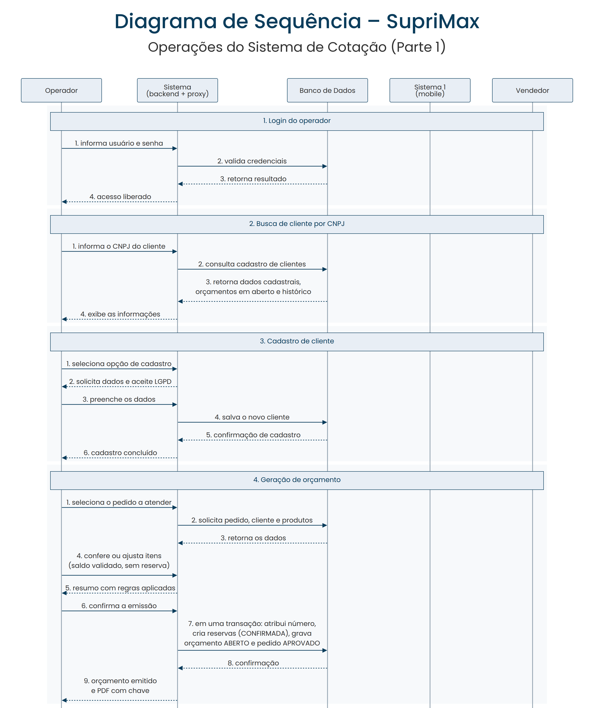
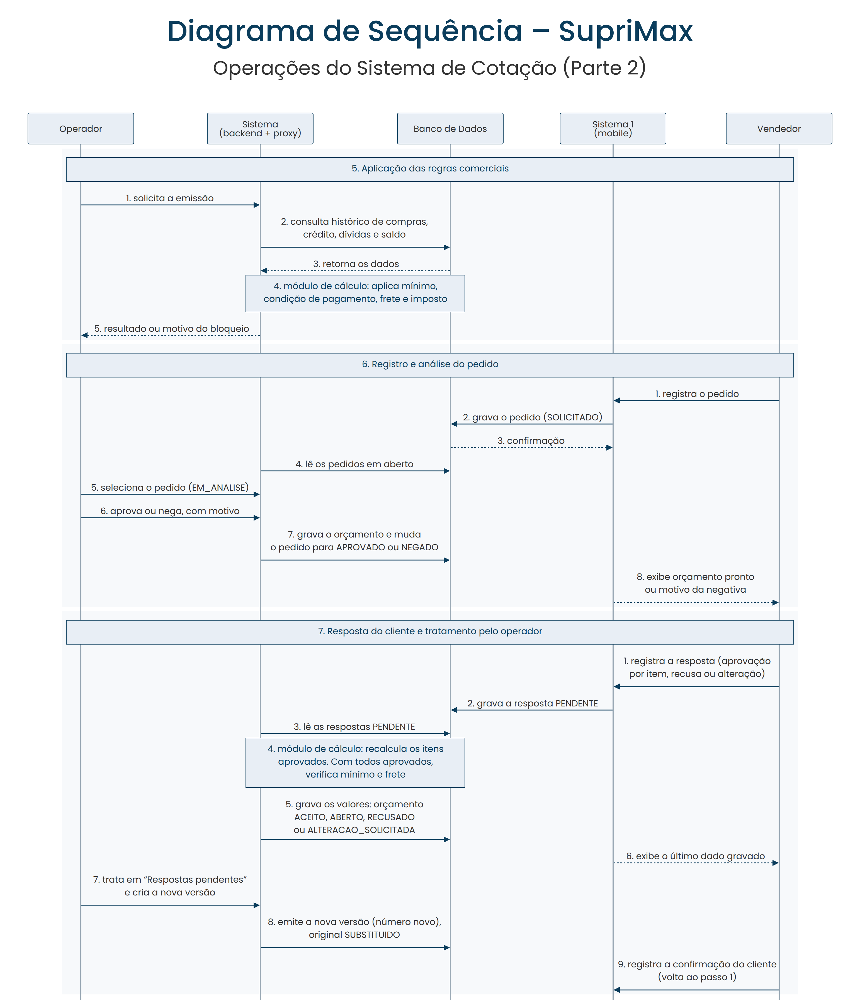

# 6. Diagramas de Sequência

Esta seção descreve as interações entre os componentes do sistema — Operador, Sistema, Banco de Dados e, nos fluxos com o Sistema 1, Vendedor — nas operações principais do módulo de cotação. Nos diagramas, “Sistema” designa o backend do Sistema 2 em conjunto com o proxy, que é transparente: as leituras e gravações no banco passam sempre pelo proxy, sem que ele apareça como participante separado. O cliente (quem compra da SupriMax) e o fornecedor (quem vende à SupriMax) não interagem diretamente com o sistema nesses fluxos. Cada fluxo é apresentado passo a passo, na ordem em que as mensagens são trocadas.

## 6.1 Visão geral das interações

Figura 1 — Diagrama de sequência consolidado das operações do Sistema de Cotação.

## 6.2 Login do operador

**Atores envolvidos:** Operador, Sistema, Banco de Dados.

| **Passo** | **Fluxo** | **Descrição** |
|---|---|---|
| 1 | Operador → Sistema | O operador informa usuário e senha nos campos de acesso e solicita a entrada no sistema. |
| 2 | Sistema → Banco de Dados | O sistema recebe as credenciais, identifica o usuário informado e envia os dados ao banco de dados para verificar se o cadastro existe e se a senha está correta. |
| 3 | Banco de Dados → Sistema | O banco de dados consulta os dados do operador, realiza a validação das credenciais e retorna o resultado da autenticação. |
| 4 | Sistema → Operador | O sistema analisa o resultado recebido; estando os dados corretos, registra o acesso e libera o operador para utilizar as funcionalidades do sistema. |

## 6.3 Busca de cliente por CNPJ

**Atores envolvidos:** Operador, Sistema, Banco de Dados.

| **Passo** | **Fluxo** | **Descrição** |
|---|---|---|
| 1 | Operador → Sistema | O operador acessa a função de busca de cliente e informa o CNPJ que deseja consultar. |
| 2 | Sistema → Banco de Dados | O sistema recebe o CNPJ, verifica se o formato está correto e envia uma solicitação ao banco de dados para localizar o cliente cadastrado. |
| 3 | Banco de Dados → Sistema | O banco de dados realiza a busca pelo CNPJ e retorna as informações encontradas: razão social, CNPJ, dados de contato, endereço, orçamentos em aberto e histórico de negociações. |
| 4 | Sistema → Operador | O sistema organiza os dados recebidos e apresenta na tela as informações do cliente localizado, permitindo a consulta do cadastro e dos registros associados. |

## 6.4 Cadastro de cliente

**Atores envolvidos:** Operador, Sistema, Banco de Dados.

| **Passo** | **Fluxo** | **Descrição** |
|---|---|---|
| 1 | Operador → Sistema | O operador acessa a opção de cadastro e solicita o registro de um novo cliente. |
| 2 | Sistema → Operador | O sistema apresenta o formulário de cadastro e solicita as informações necessárias: CNPJ, razão social, nome do responsável, telefone, e-mail e endereço, além do aceite da cláusula de consentimento LGPD (RF20). |
| 3 | Operador → Sistema | O operador preenche todos os campos solicitados e envia as informações para registro do novo cliente. |
| 4 | Sistema → Banco de Dados | O sistema recebe os dados, realiza as validações necessárias e solicita ao banco de dados o armazenamento das informações do cliente. |
| 5 | Banco de Dados → Sistema | O banco de dados verifica o cadastro, armazena os dados e retorna a confirmação de que o cliente foi registrado com sucesso. |
| 6 | Sistema → Operador | O sistema recebe a confirmação e apresenta mensagem informando que o cadastro do cliente foi concluído. |

## 6.5 Geração de orçamento

**Atores envolvidos:** Operador, Sistema, Banco de Dados.

| **Passo** | **Fluxo** | **Descrição** |
|---|---|---|
| 1 | Operador → Sistema | O operador seleciona, na fila de pedidos registrados pelo Sistema 1, o pedido que vai atender (ou inicia um orçamento avulso) e o assume. |
| 2 | Sistema → Banco de Dados | O sistema solicita o pedido e seus itens, os dados do cliente e os produtos disponíveis para a montagem do orçamento. |
| 3 | Banco de Dados → Sistema | O banco de dados retorna os dados do pedido, do cliente e dos produtos (código, descrição, variações, faixas de preço, fardos e saldo). |
| 4 | Operador → Sistema | O operador confere ou ajusta produtos e quantidades. A cada inclusão, o sistema valida o saldo disponível, sem reservar estoque. |
| 5 | Sistema → Operador | O sistema aplica as regras comerciais (ver 6.6) e apresenta o resumo do orçamento para conferência. |
| 6 | Operador → Sistema | O operador confirma a emissão do orçamento. |
| 7 | Sistema → Banco de Dados | Em uma única transação, o sistema atribui o número do orçamento, cria as reservas de estoque (CONFIRMADA), grava o orçamento como ABERTO, vincula-o ao pedido e atualiza o pedido para ATENDIDO. |
| 8 | Banco de Dados → Sistema | O banco de dados confirma a gravação. |
| 9 | Sistema → Operador | O sistema apresenta o orçamento emitido e o PDF gerado, com a chave de segurança. |

## 6.6 Aplicação das regras comerciais

**Atores envolvidos:** Operador, Sistema, Banco de Dados.

| **Passo** | **Fluxo** | **Descrição** |
|---|---|---|
| 1 | Operador → Sistema | O operador solicita o fechamento (emissão) do orçamento após conferir os produtos e valores apresentados. |
| 2 | Sistema → Banco de Dados | O sistema consulta os dados necessários às regras comerciais: histórico de compras do cliente (primeira compra), análise de crédito, dívidas em aberto e saldo de estoque. |
| 3 | Banco de Dados → Sistema | O banco de dados retorna os dados consultados. |
| 4 | Sistema → Módulo de cálculo | O sistema entrega ao módulo de cálculo os valores e condições, que aplica faturamento mínimo, condição de pagamento (prazo, parcelamento ou adiantamento), frete e imposto. O módulo é puro: não acessa o banco. |
| 5 | Módulo de cálculo → Sistema | O módulo devolve os valores e condições aplicáveis ou o motivo do bloqueio (por exemplo, abaixo do mínimo ou crédito pendente). |
| 6 | Sistema → Operador | O sistema apresenta o resultado para decisão; sem bloqueios, o operador emite o orçamento (ver 6.5). |

## 6.7 Registro e análise do pedido

**Atores envolvidos:** Vendedor, Sistema 1, Banco de Dados, Operador (Sistema 2).

| **Passo** | **Fluxo** | **Descrição** |
|---|---|---|
| 1 | Vendedor → Sistema 1 | O vendedor registra o pedido de orçamento: cliente, produtos desejados (variação, fardo ou avulso e quantidade) e configuração (endereço de entrega, número da solicitação de compra, contato e condições desejadas). |
| 2 | Sistema 1 → Banco de Dados | O backend do Sistema 1 grava o pedido e seus itens no banco compartilhado, através do proxy, com status SOLICITADO. |
| 3 | Banco de Dados → Sistema 1 | O banco de dados confirma a gravação. |
| 4 | Sistema 2 → Banco de Dados | O Sistema 2 lê a lista de pedidos em aberto (SOLICITADO), que se atualiza conforme o Sistema 1 grava no banco. |
| 5 | Operador → Sistema 2 | O operador seleciona um pedido; ele passa a EM_ANALISE. |
| 6 | Operador → Sistema 2 | O operador analisa se é possível atender o pedido e decide: aprovar (monta e emite o orçamento, ver 6.5) ou negar, informando o motivo. |
| 7 | Sistema 2 → Banco de Dados | O Sistema 2 grava o orçamento emitido e muda o pedido para APROVADO, ou muda o pedido para NEGADO com o motivo. |
| 8 | Sistema 1 → Vendedor | O Sistema 1 lê o status do pedido no banco e exibe ao vendedor o orçamento pronto ou o motivo da negativa. |

## 6.8 Resposta do cliente e tratamento pelo operador

**Atores envolvidos:** Vendedor, Sistema 1, Banco de Dados, Sistema 2, Operador.

| **Passo** | **Fluxo** | **Descrição** |
|---|---|---|
| 1 | Vendedor → Sistema 1 | O vendedor registra a resposta do cliente: aprovação ou não aprovação por item (com a quantidade aprovada), recusa ou pedido de alteração, com justificativa opcional. |
| 2 | Sistema 1 → Banco de Dados | O Sistema 1 grava a resposta e seus itens com status PENDENTE. |
| 3 | Sistema 2 → Banco de Dados | O Sistema 2 lê as respostas PENDENTE. |
| 4 | Sistema 2 → Módulo de cálculo | O módulo recalcula os itens aprovados (faixa de preço e imposto por linha). Se todos estão aprovados, verifica o faturamento mínimo e o frete sobre o total aceito. |
| 5 | Sistema 2 → Banco de Dados | O Sistema 2 grava os valores consolidados e atualiza o orçamento: ACEITO (com baixa de estoque), continua ABERTO (itens não aprovados), RECUSADO ou ALTERACAO_SOLICITADA. Quando é preciso tratamento, a resposta vai para a lista do operador. |
| 6 | Sistema 1 → Vendedor | O Sistema 1 exibe ao vendedor o último dado gravado. |
| 7 | Operador → Sistema 2 | Na tela “Respostas pendentes”, o operador lê a justificativa e a situação dos itens e cria a nova versão do orçamento, alterando ou removendo itens (ver 6.5). |
| 8 | Sistema 2 → Banco de Dados | Ao emitir a nova versão (número novo, 30 novos dias), o Sistema 2 marca o orçamento original como SUBSTITUIDO e a resposta como TRATADA. |
| 9 | Vendedor → Sistema 1 | O vendedor registra a confirmação do cliente sobre a nova versão; o fluxo volta ao passo 1. |
