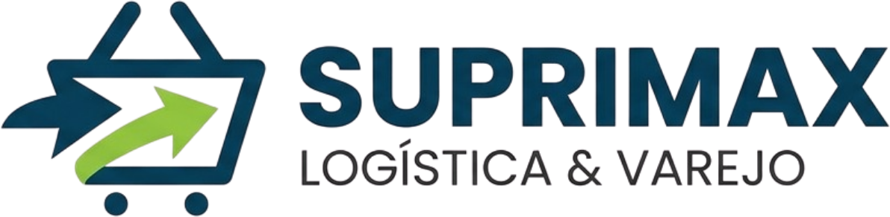

# 7. Identidade Visual

Esta seção documenta, como referência, a identidade visual definida para a marca SupriMax. Os tons abaixo orientam os elementos gráficos deste documento e dos demais materiais do produto.

## 7.1 Nome da empresa

SupriMax — nome fictício adotado para o projeto.

## 7.2 Paleta de cores

A paleta oficial da marca é composta pelas cinco cores abaixo. Para uso em textos longos e áreas extensas de fundo, como neste documento, aplicam-se versões suavizadas (menos saturadas) dos mesmos tons, preservando a identidade cromática com mais conforto de leitura.

|  | **Cor** | **Uso no documento** | **Hex oficial** | **Hex suavizado** |
|---|---|---|---|---|
|  | **Azul petróleo** | Cor primária — títulos, capa e elementos de destaque | 0B3D5C | 3B6E8C |
|  | **Verde-limão** | Cor de destaque — subtítulos e marcadores de lista | 8DC63F | 6E9450 |
|  | **Cinza-grafite** | Texto corrido | 333333 | 444444 |
|  | **Off-white** | Fundo e zebra de tabelas | F7F7F7 | F7F7F7 |
|  | **Laranja** | Alertas e avisos | F2994A | E2A26B |

As demais tonalidades usadas neste documento — como o preenchimento do cabeçalho das tabelas e as linhas de bordas — são tintas claras derivadas do azul petróleo, mantendo a mesma identidade cromática de forma suavizada.

## 7.3 Conceito de logo

Ícone que combina um elemento de seta, representando logística, com um carrinho minimalista, representando o segmento de supermercado/atacado. A tipografia da assinatura é sans-serif geométrica — Poppins, conforme a seção 8.3. O arquivo oficial é fornecido em PNG com fundo transparente.

Figura 2 — Logotipo SupriMax, versão full color em fundo transparente.
