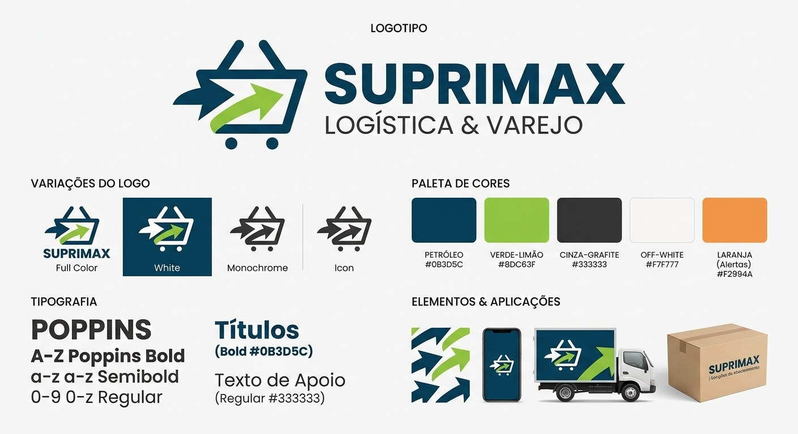

# 8. Estilo Visual

Enquanto a seção 7 registra a identidade da marca, esta seção define como essa identidade é aplicada: nas telas do Sistema de Cotação, nos documentos gerados por ele e nos materiais de apoio. O objetivo é que os três sistemas da solução compartilhem a mesma linguagem visual, de modo que qualquer tela ou documento seja imediatamente reconhecível como SupriMax.

## 8.1 Manual de marca

O quadro abaixo consolida o logotipo, suas variações, a paleta oficial, a tipografia e exemplos de aplicação da marca. Ele serve como referência rápida para a equipe de desenvolvimento e para a produção de materiais.

Figura 3 — Manual de marca SupriMax: logotipo, variações, paleta, tipografia e aplicações.

## 8.2 Logotipo e regras de uso

O logotipo possui quatro versões oficiais. A escolha depende do fundo e do espaço disponível na aplicação.

| **Versão** | **Quando usar** |
|---|---|
| **Full color** | Versão padrão, para fundos claros: capa e cabeçalho deste documento, cabeçalho do sistema web, PDF de orçamento e materiais impressos. |
| **Negativa (branca)** | Para fundos escuros em azul petróleo: barra superior, tela de login, splash do aplicativo mobile e envelopamento de veículos. |
| **Monocromática** | Para impressões em preto e branco, documentos sem cor, carimbos e fax. |
| **Ícone (símbolo isolado)** | Sem a assinatura, para espaços reduzidos: favicon, ícone do aplicativo, avatar do usuário, menu lateral recolhido e marca d’água. |

Regras de aplicação:

- Área de proteção livre em todos os lados equivalente à altura do símbolo do carrinho; nenhum texto ou elemento gráfico pode invadir esse espaço.
- Largura mínima da versão com assinatura: 24 mm em impresso e 120 px em tela. Abaixo disso, usar apenas o ícone.
- Sobre fundos coloridos, fotos ou elementos gráficos, aplicar sempre o arquivo PNG com fundo transparente, na versão de maior contraste.
- Não distorcer, rotacionar, recolorir, aplicar sombra ou contorno, nem alterar a proporção entre símbolo e assinatura.

## 8.3 Tipografia

A família tipográfica oficial é a Poppins, sans-serif geométrica, aplicada em todas as interfaces e documentos. Quando a fonte não estiver disponível no ambiente, utiliza-se Inter e, em último caso, a sans-serif padrão do sistema operacional.

| **Nível** | **Peso e tamanho** | **Uso** |
|---|---|---|
| **Título de tela** | Bold, 24 px | Título principal da página, em azul petróleo. |
| **Título de seção** | SemiBold, 20 px | Blocos internos da tela, cabeçalhos de cards e de modais. |
| **Rótulo de campo** | SemiBold, 14 px | Labels de formulário, cabeçalhos de tabela e abas. |
| **Texto corrido** | Regular, 16 px | Conteúdo de leitura, em cinza-grafite. |
| **Texto auxiliar** | Regular, 12–13 px | Legendas, mensagens de apoio e textos legais, como a cláusula LGPD. |
| **Valores numéricos** | Regular, alinhamento à direita | Quantidades, preços, impostos e totais, no formato R$ 0.000,00. |

Nenhum texto de interface deve ser exibido abaixo de 12 px. Títulos usam caixa alta apenas no logotipo; nas telas, adota-se caixa normal.

## 8.4 Aplicação das cores na interface

As cores oficiais da seção 7.2 são aplicadas às telas conforme a função de cada elemento, e não por preferência estética de cada tela.

| **Cor** | **Aplicação no sistema** |
|---|---|
| **Azul petróleo #0B3D5C** | Barra superior, menu lateral, títulos, botões primários e cabeçalho das tabelas de cotação. |
| **Verde-limão #8DC63F** | Confirmações e estados de sucesso (cotação salva, crédito aprovado, compra fechada), destaque de totais e indicadores positivos do painel. |
| **Cinza-grafite #333333** | Texto corrido, rótulos e conteúdo de tabelas. |
| **Off-white #F7F7F7** | Fundo das telas, zebra de tabelas e fundo de cards. |
| **Laranja #F2994A** | Alertas e pendências: pop-up de vencimento do orçamento (RF16), divergência na entrada de mercadoria (RF19), produto sem estoque disponível (RF18) e aviso de faturamento mínimo. |

A paleta não prevê vermelho. Bloqueios e recusas são sinalizados com o laranja, sempre acompanhados de ícone e texto explicativo, de forma que a informação não dependa apenas da cor.

## 8.5 Componentes de interface

Os componentes abaixo são compartilhados pelos três sistemas e devem manter o mesmo comportamento visual em todas as telas.

| **Componente** | **Padrão visual** |
|---|---|
| **Botão primário** | Fundo azul petróleo, texto branco em Poppins SemiBold, cantos arredondados de 6 px. |
| **Botão secundário** | Fundo transparente com contorno e texto em azul petróleo. |
| **Botão de confirmação** | Verde-limão com texto em azul petróleo, reservado a ações que concluem um fluxo, como fechar cotação. |
| **Campos de formulário** | Borda de 1 px em cinza claro, foco em azul petróleo e mensagem de erro em laranja logo abaixo do campo. |
| **Tabelas de cotação e histórico** | Cabeçalho em azul petróleo com texto branco, zebra em off-white e valores alinhados à direita. |
| **Cards de indicadores** | Fundo branco, rótulo em cinza e número em Poppins Bold azul petróleo; usados pelos dados agregados do RF17. |
| **Modais e pop-ups** | Largura máxima de 560 px, título em azul petróleo e ações alinhadas à direita; formato do aviso de atualização de status (RF16). |
| **Estados do sistema** | Carregamento por skeleton, tela vazia com orientação de próxima ação e mensagens de sucesso ou alerta sempre com ícone e texto. |
| **Anexos da cotação** | Lista com ícone por tipo de arquivo, nome e tamanho, conforme o RF11. |

## 8.6 Aplicação no documento de orçamento

O PDF descrito na seção 9 é o material da marca que chega ao cliente e segue os mesmos padrões:

- Logotipo full color no canto superior esquerdo do cabeçalho, com os dados da empresa emissora ao lado e o número sequencial de cinco dígitos em destaque à direita.
- Filete em azul petróleo separando o cabeçalho do corpo do documento.
- Tabela de produtos com cabeçalho em azul petróleo, zebra em off-white e colunas de valores alinhadas à direita, com o imposto de 18% destacado por item.
- Total da proposta com impostos inclusos destacado em bloco próprio, marcado por filete verde-limão.
- Avisos e ressalvas — faturamento mínimo, análise de crédito e flutuação de estoque — em laranja, com ícone e texto.
- Cláusula de consentimento LGPD no rodapé, em Poppins Regular de 8 a 9 pt, em cinza.

## 8.7 Acessibilidade e consistência

- Contraste mínimo de 4,5:1 para texto corrido e 3:1 para texto grande e ícones.
- O verde-limão sobre branco não atinge contraste suficiente para texto: deve ser usado em áreas de preenchimento, ícones e barras, com o texto em azul petróleo ou cinza-grafite.
- A cor nunca é o único indicador de estado; alertas, erros e confirmações combinam cor, ícone e texto.
- Área mínima de toque de 44 × 44 px nas telas do Sistema 1 (mobile).
- Cores, tipografia e componentes são mantidos como tokens compartilhados, versionados junto ao código do frontend e alterados apenas em conjunto pelos responsáveis dos três sistemas.
