# 10. Frontend do Sistema 2

Esta seção especifica o frontend web do Sistema 2 (Sistema de Cotação Web), utilizado em desktop pelos perfis internos da SupriMax. O detalhamento parte de 18 telas de wireframe de média fidelidade, sintetizadas nas subseções a seguir, e cada tela é acompanhada de uma imagem de exemplo. As imagens ilustram o conteúdo e a disposição dos elementos; não representam o design visual final e podem conter pequenas imperfeições de diagramação (sobreposição de rótulos, textos cortados) que não fazem parte da especificação. Quando texto e imagem divergirem, vale o texto.

## 10.1 Escopo e premissas

- Tecnologia e comunicação: o frontend é uma aplicação React, hospedada na Vercel (seção 3.1). Ele consome apenas a API REST do backend do Sistema 2, com autenticação por token de sessão (seção 11.2). Não acessa o proxy nem o banco de dados (seção 11.1).
- Incluído: telas web desktop do Sistema 2 — fluxo de pedidos, análise e montagem de orçamentos, respostas pendentes, clientes, produtos e estoque, entrada de mercadoria, fornecedores, análise de crédito, dívidas, usuários, além da biblioteca de componentes e estados.
- Fora do escopo: aplicativo mobile do vendedor (Sistema 1), painel gerencial e BI (Sistema 3), gráficos de lucro, protótipo interativo e design visual final.
- Referência de tela: quadros de 1440 × 1024 px em português do Brasil. A largura mínima suportada é 1280 px, nos navegadores Chrome, Edge e Firefox recentes (RNF08).
- Regra de conteúdo: as telas mostram somente os campos e as funcionalidades especificados nesta seção, com os rótulos e os valores de status exatamente como documentados.
- Identidade visual: paleta (seção 7.2), tipografia (8.3), aplicação das cores (8.4), componentes (8.5) e acessibilidade (8.7) valem integralmente. Esta seção acrescenta apenas o que é específico das telas do Sistema 2.

## 10.2 Estrutura global e visibilidade por perfil

Todas as telas, exceto o login, compartilham a mesma moldura. A barra superior, em azul petróleo, reúne o logotipo em versão branca (com o ícone de seta e carrinho), a busca global, o nome e o perfil do usuário e a ação Sair. O menu lateral, também em azul petróleo, lista os módulos do sistema e mostra um contador ao lado de Respostas pendentes. A área de conteúdo usa o fundo off-white. O login é a única tela sem barra superior e sem menu.

Itens do menu: Pedidos, Orçamentos, Respostas pendentes, Clientes, Produtos, Entrada de mercadoria, Fornecedores, Análise de crédito, Dívidas e Usuários. O ajuste de estoque (tela 14) é acessado a partir de Produtos. Nos quadros de exemplo o menu aparece completo, com a indicação “visibilidade por perfil”; na aplicação, cada usuário vê apenas os itens do seu perfil.

| **Perfil** | **Itens do menu visíveis** |
|---|---|
| **Operador** | Pedidos, Orçamentos, Respostas pendentes, Clientes (consulta e cadastro), Produtos (consulta e cadastro de produtos e variações) e Entrada de mercadoria (registro). |
| **Operador chefe** | Todos os itens, exceto Análise de crédito e Dívidas. É o único perfil que altera faixas de preço e fardos, ajusta estoque, libera divergências de entrada, cadastra fornecedores e gerencia usuários. |
| **Fiscal** | Análise de crédito. |
| **Financeiro** | Dívidas. |
| **Vendedor e Gestor** | Sem menu no Sistema 2: o vendedor atua no Sistema 1 e o gestor, no Sistema 3. |

Ocultar um item é apenas conveniência de interface. A autorização de cada operação é verificada no backend e, em última instância, pelo escopo do integrante no proxy (seção 12.3).

## 10.3 Componentes e padrões de interface

Os componentes seguem a seção 8.5. Na tabela abaixo estão os padrões de uso que as telas do Sistema 2 aplicam a eles.

| **Componente** | **Como é usado nas telas** |
|---|---|
| **Botões** | Primário para a ação principal da tela; secundário para ações alternativas; confirmação (verde-limão, texto em azul petróleo) apenas para concluir um fluxo, como Emitir orçamento, Emitir nova versão e registrar Aprovado na análise de crédito. O botão desabilitado indica ação indisponível e vem sempre acompanhado de mensagem com o motivo. |
| **Campos** | Borda cinza, foco em azul petróleo, erro em laranja logo abaixo do campo. Campo opcional traz “(opcional)” no rótulo; campo obrigatório justificado (motivo) é rotulado como tal. |
| **Tabelas** | Cabeçalho em azul petróleo com texto branco, linhas alternadas em off-white, valores numéricos alinhados à direita e valores monetários no formato R$ 0.000,00. |
| **Alertas** | Sempre em laranja, com ícone e texto. Servem a avisos, pendências e bloqueios. |
| **Modais** | Largura máxima de 560 px, título em azul petróleo e ações à direita. Usados para negar pedido, cancelar orçamento, confirmar a substituição do original, liberar divergência de entrada e indicar novo vendedor responsável. |
| **Carregamento e vazio** | Skeleton enquanto os dados carregam; tela vazia com orientação da próxima ação quando não há dados (por exemplo, CNPJ não encontrado, com o botão Cadastrar cliente). |
| **Cards de indicadores** | Números de acompanhamento operacional da fila de pedidos. Não substituem o painel gerencial do Sistema 3. |

## 10.4 Status e badges

Todo status é exibido como badge com ícone e texto, e o texto é sempre o valor literal do status. A cor acompanha a função do estado (informativo ou neutro, sucesso, pendência ou bloqueio), mas nunca é o único indicador.

| **Domínio** | **Valores** | **Onde aparece** |
|---|---|---|
| **Pedido** | SOLICITADO, EM_ANALISE, APROVADO, NEGADO, CANCELADO | Pedidos em aberto; análise do pedido |
| **Orçamento** | RASCUNHO, PENDENTE_CREDITO, ABERTO, ALTERACAO_SOLICITADA, ACEITO, RECUSADO, CANCELADO, SUBSTITUIDO, EXPIRADO | Montagem, lista e detalhe do orçamento |
| **Item do orçamento** | APROVADO, NAO_APROVADO; selo adicional “Aprovação herdada” | Detalhe do orçamento emitido; tratamento da resposta |
| **Tipo de resposta pendente** | RECUSA, ALTERACAO, ITENS_NAO_APROVADOS, ABAIXO_DO_MINIMO | Lista de respostas pendentes |
| **Cliente** | ATIVO, INATIVO, BLOQUEADO | Ficha do cliente |
| **Dívida** | EM_ABERTO, RENEGOCIADA, QUITADA, PROTESTADA | Dívidas |
| **Usuário** | ATIVO, INATIVO | Usuários |

## 10.5 Visão geral das telas

A tabela relaciona as 18 telas aos casos de uso (seção 5), aos perfis que as utilizam e às principais tabelas que alimentam cada uma (seção 13). As ações que gravam passam pelo backend; três delas acionam as operações nomeadas do proxy (seção 12.8.3): Selecionar pedido (pedido.assumir), Emitir orçamento e Emitir nova versão (orcamento.emitir). O processamento da resposta do cliente (resposta.processar) é automático (UC20) e não tem tela.

| **Nº** | **Tela** | **Perfis** | **Principais tabelas** |
|---|---|---|---|
| 1 | **UC13 – Login** | Todos | operador |
| 2 | **UC10 – Pedidos em aberto** | Operador, Operador chefe | pedido, item_pedido, cliente, operador |
| 3 | **UC10 – Análise do pedido** | Operador, Operador chefe | pedido, item_pedido, variacao_produto, reserva_estoque, analise_credito, divida_inadimplencia |
| 4 | **UC03 – Clientes: busca por CNPJ** | Operador, Operador chefe | cliente, endereco_cliente, orcamento, divida_inadimplencia |
| 5 | **UC02 – Cadastro de cliente** | Operador, Operador chefe | cliente, endereco_cliente |
| 6 | **UC01/UC14–UC19 – Orçamento: montagem (rascunho)** | Operador, Operador chefe | orcamento, item_orcamento, produto, variacao_produto, faixa_preco, fardo, anexo_orcamento |
| 7 | **UC03 – Orçamentos: lista** | Operador, Operador chefe | orcamento, cliente |
| 8 | **UC08/UC19 – Orçamento emitido: detalhe** | Operador, Operador chefe | orcamento, item_orcamento, item_resposta_orcamento, historico_orcamento |
| 9 | **UC21 – Respostas pendentes: lista** | Operador, Operador chefe | resposta_orcamento, orcamento, cliente, operador |
| 10 | **UC21 – Tratar resposta e nova versão** | Operador, Operador chefe | orcamento, item_orcamento, resposta_orcamento, item_resposta_orcamento |
| 11 | **UC07 – Análise de crédito** | Fiscal | analise_credito, documento_analise_credito, cliente |
| 12 | **UC23 – Dívidas** | Financeiro | divida_inadimplencia, cliente |
| 13 | **UC04 – Produtos: cadastro** | Operador, Operador chefe | produto, variacao_produto, faixa_preco, fardo |
| 14 | **UC24 – Ajuste de estoque** | Operador chefe | variacao_produto, movimentacao_estoque, reserva_estoque |
| 15 | **UC04 – Entrada de mercadoria** | Operador, Operador chefe | entrada_mercadoria, fornecedor, variacao_produto, movimentacao_estoque |
| 16 | **UC22 – Fornecedores** | Operador chefe | fornecedor |
| 17 | **UC25 – Usuários** | Operador chefe | operador, cliente |
| 18 | **Componentes e estados** | — | — |

## 10.6 Especificação das telas

### 10.6.1 Tela 1 – UC13 – Login

Autentica o usuário interno. Reúne o logotipo, os campos usuário e senha, o botão de login e o link Esqueci minha senha.

- Credenciais inválidas: mensagem de erro em laranja, com ícone e texto.
- Conta bloqueada: após 3 tentativas erradas, indicação de bloqueio temporário em laranja.
- Recuperação de senha: campo de e-mail e confirmação do envio do link.

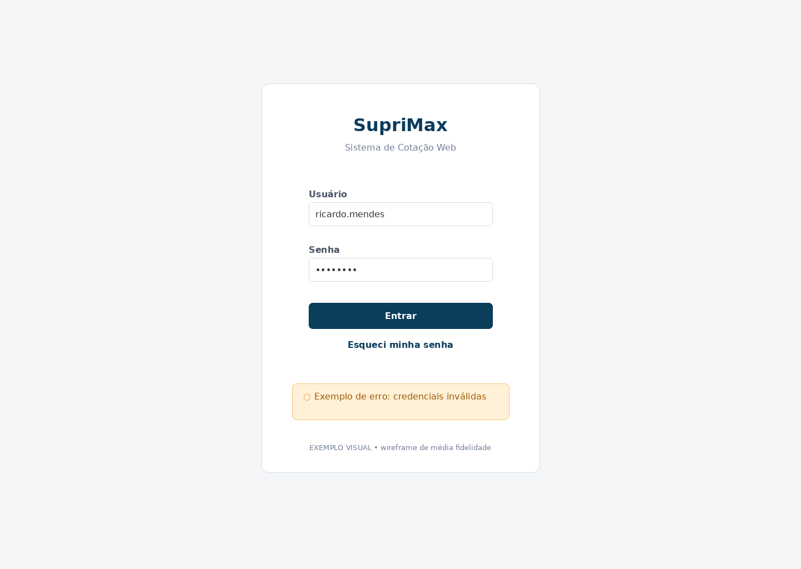

Figura 10.1 — Tela 1 (UC13 – Login): exemplo visual.

### 10.6.2 Tela 2 – UC10 – Pedidos em aberto

Fila dos pedidos registrados pelo Sistema 1. Quatro cards resumem a operação (Aguardando análise, Em análise, Orçamentos em aberto e Pendentes de crédito), seguidos da tabela de pedidos com número, cliente, vendedor, data da solicitação, itens e status. Esta tela é a referência de acabamento visual das demais.

- Ação Selecionar pedido: o pedido passa a EM_ANALISE e deixa de aparecer na lista dos demais operadores.
- O pedido já assumido por outro operador aparece sem a ação de seleção.

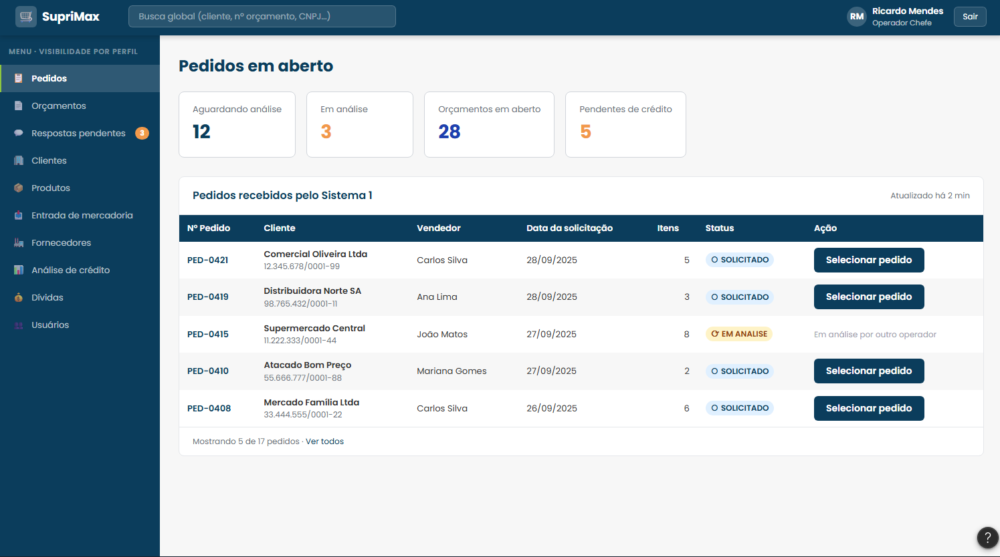

Figura 10.2 — Tela 2 (UC10 – Pedidos em aberto): exemplo visual.

### 10.6.3 Tela 3 – UC10 – Análise do pedido

Permite avaliar se o pedido pode ser atendido. O cabeçalho mostra o status EM_ANALISE. A tela traz os itens desejados (produto, marca, embalagem, Fardo/Avulso, quantidade solicitada e saldo disponível), a configuração do pedido e a situação do cliente.

- Configuração do pedido: endereço de entrega, nº da solicitação de compra, contato, condição de pagamento desejada, prazo do boleto desejado, nº de parcelas desejado, transportadora indicada e observações.
- Situação do cliente: indicadores de crédito e de dívida em aberto.
- Ações: Aprovar e montar orçamento (primária); Negar pedido (secundária), que abre modal com Motivo da negativa obrigatório; Devolver à lista.

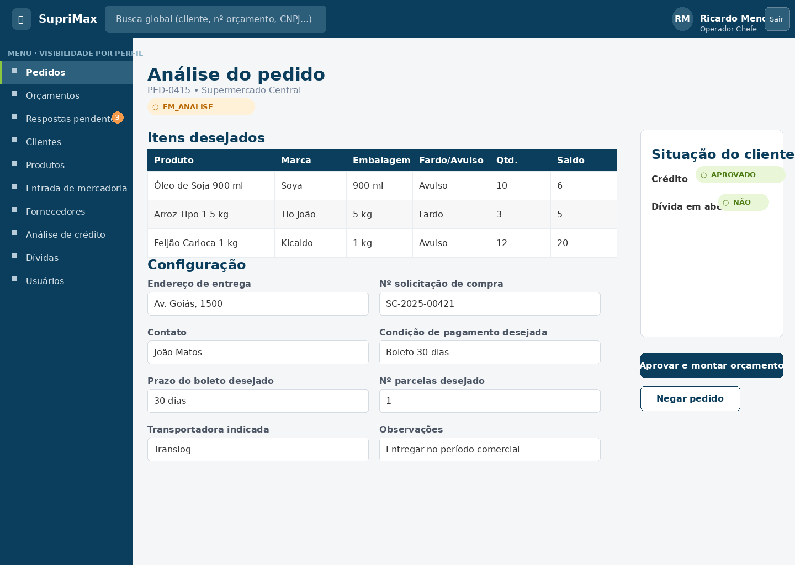

Figura 10.3 — Tela 3 (UC10 – Análise do pedido): exemplo visual.

### 10.6.4 Tela 4 – UC03 – Clientes: busca por CNPJ

Consulta de cliente por CNPJ. A ficha mostra razão social, nome do contato, telefone, e-mail, tipo (Matriz/Filial), status, vendedor responsável e endereços (Cadastral e Entrega), com abas para Orçamentos em aberto e Histórico de compras.

- Dívida em aberto: alerta laranja informando que novo orçamento está bloqueado.
- CNPJ não encontrado: estado vazio com o botão Cadastrar cliente.

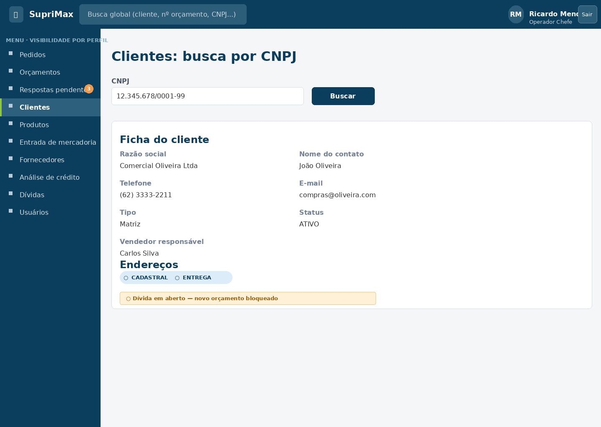

Figura 10.4 — Tela 4 (UC03 – Clientes: busca por CNPJ): exemplo visual.

### 10.6.5 Tela 5 – UC02 – Cadastro de cliente

Cadastro de um novo cliente. Campos: CNPJ, razão social, nome do contato, telefone (opcional), e-mail (opcional), tipo de unidade (Matriz/Filial) e vendedor responsável. Aceita vários endereços, cada um com tipo, logradouro, número, complemento, bairro, cidade, UF e CEP.

- Consentimento LGPD: checkbox obrigatório com texto auxiliar; o botão Salvar permanece desabilitado até o aceite.

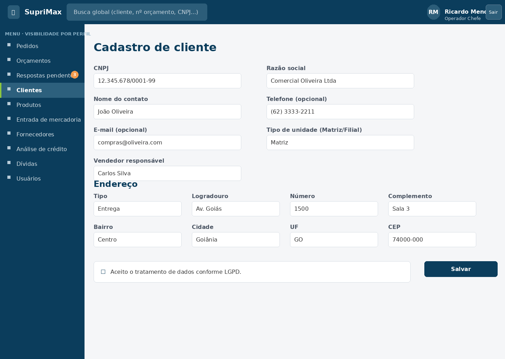

Figura 10.5 — Tela 5 (UC02 – Cadastro de cliente): exemplo visual.

### 10.6.6 Tela 6 – UC01/UC14–UC19 – Orçamento: montagem (rascunho)

Tela principal do fluxo de cotação, em duas colunas. À esquerda ficam o cabeçalho (cliente, pedido de origem, status RASCUNHO, “Nº atribuído na emissão”, aviso “Expira em 30 dias sem edição”, nº da solicitação de compra, contato, endereço de entrega e prazo de entrega em dias), a busca de produtos e a grade de itens. À direita, o painel fixo Condições comerciais.

- Busca por descrição, código interno ou EAN, com filtros cumulativos de marca, peso/variação e categoria. O resultado mostra preço por faixa (por exemplo, 1–3 un = R$ 25,00; 4+ un = R$ 19,00), preço do fardo, unidades por fardo e disponibilidade.
- Grade de itens: produto, granularidade (Fardo/Avulso), quantidade, preço aplicado, valor da linha, imposto de 18%, total do item e remover. No exemplo: Óleo de Soja 900 ml, 10 un × R$ 19,00, total R$ 224,20; Arroz Tipo 1 5 kg, 3 fardos × R$ 47,50, total R$ 168,15; subtotal R$ 392,35.
- Painel Condições comerciais: subtotal com imposto, imposto total, frete (CIF/FOB, origem da transportadora, transportadora e “frete provisório”, sempre em destaque), condição de pagamento (adiantado 100%, boleto de 10/15/20/28/30 dias, parcelado até 6x, 50%/50%), situação do crédito, anexos (descritivo técnico e material de apoio) e o botão verde Emitir orçamento.
- Abaixo do mínimo: alerta laranja “Abaixo do faturamento mínimo de R$ 500,00 – faltam R$ 107,65” e emissão desabilitada.
- Variação sem estoque: a inclusão é bloqueada e a tela não substitui automaticamente por outra variação. Timeout da consulta de estoque: opção Tentar novamente.
- PENDENTE_CREDITO: emissão bloqueada. Estoque insuficiente na emissão: mensagem do UC19 (E5), com produto, saldo disponível e quantidade no orçamento.

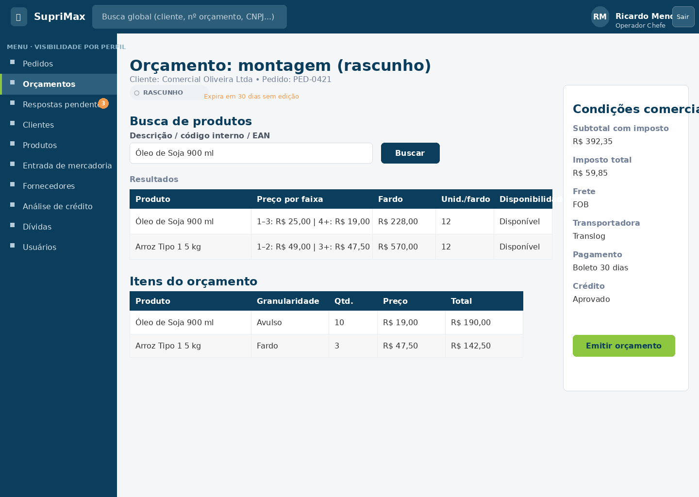

Figura 10.6 — Tela 6 (UC01/UC14–UC19 – Orçamento: montagem (rascunho)): exemplo visual.

### 10.6.7 Tela 7 – UC03 – Orçamentos: lista

Consulta dos orçamentos. Filtros: status, cliente, CNPJ, número e período. Colunas: nº, cliente, data de emissão, vencimento, valor total e status.

- O vencimento mostra também “vence em N dias”.

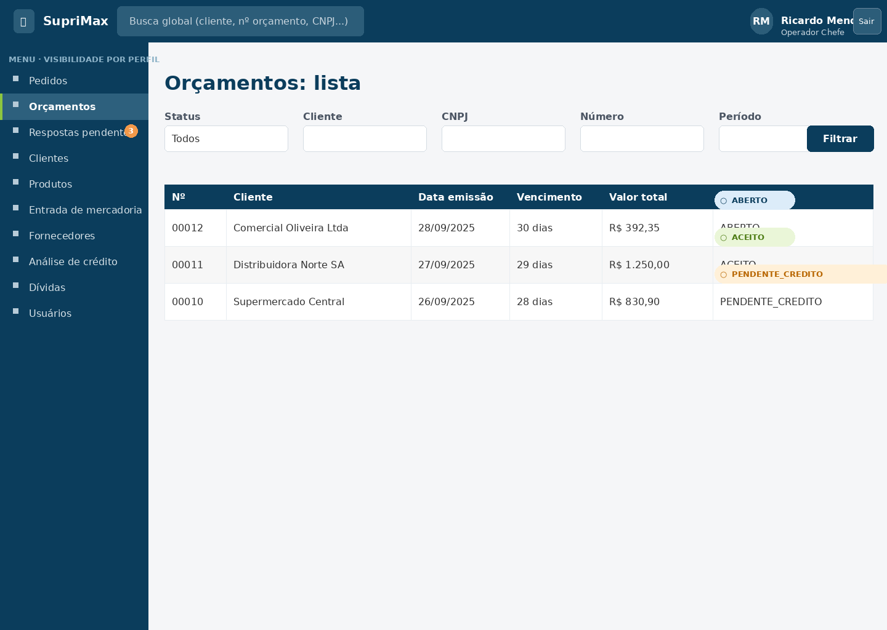

Figura 10.7 — Tela 7 (UC03 – Orçamentos: lista): exemplo visual.

### 10.6.8 Tela 8 – UC08/UC19 – Orçamento emitido: detalhe

Visão do orçamento já emitido: número (por exemplo, 00012), status ABERTO, data de emissão, vencimento em 30 dias, chave de segurança e pedido de origem. A tabela de itens ganha a coluna Situação (APROVADO ou NAO_APROVADO) e os totais mostram itens, imposto, frete e total da proposta.

- Pré-visualização do PDF e ações Baixar PDF, Enviar e Cancelar orçamento; esta última abre modal com Justificativa (opcional).
- Histórico de versões e linha do tempo.
- Aviso permanente: “Imutável: para alterar, crie uma nova versão”.

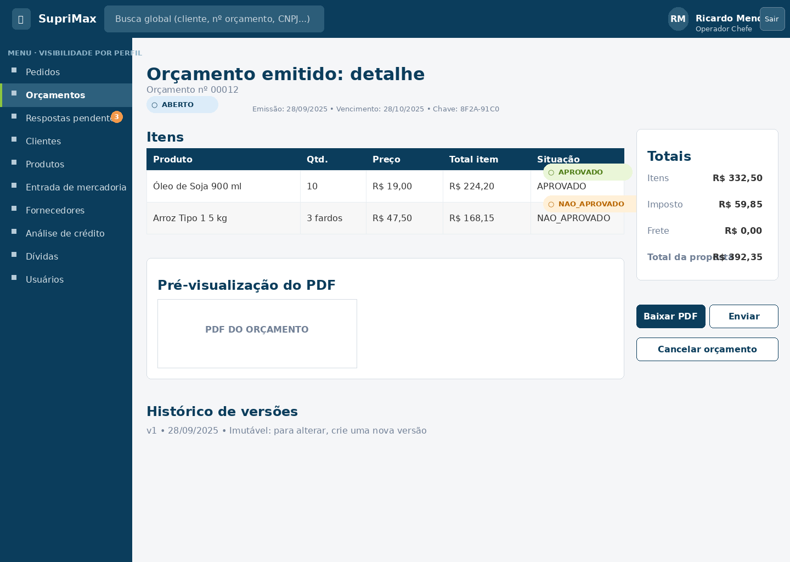

Figura 10.8 — Tela 8 (UC08/UC19 – Orçamento emitido: detalhe): exemplo visual.

### 10.6.9 Tela 9 – UC21 – Respostas pendentes: lista

Lista as respostas do cliente que exigem tratamento do operador. Colunas: orçamento, cliente, vendedor, tipo e data da resposta. Filtros por tipo e por vendedor.

- Tipos exibidos como badge: RECUSA, ALTERACAO, ITENS_NAO_APROVADOS e ABAIXO_DO_MINIMO.

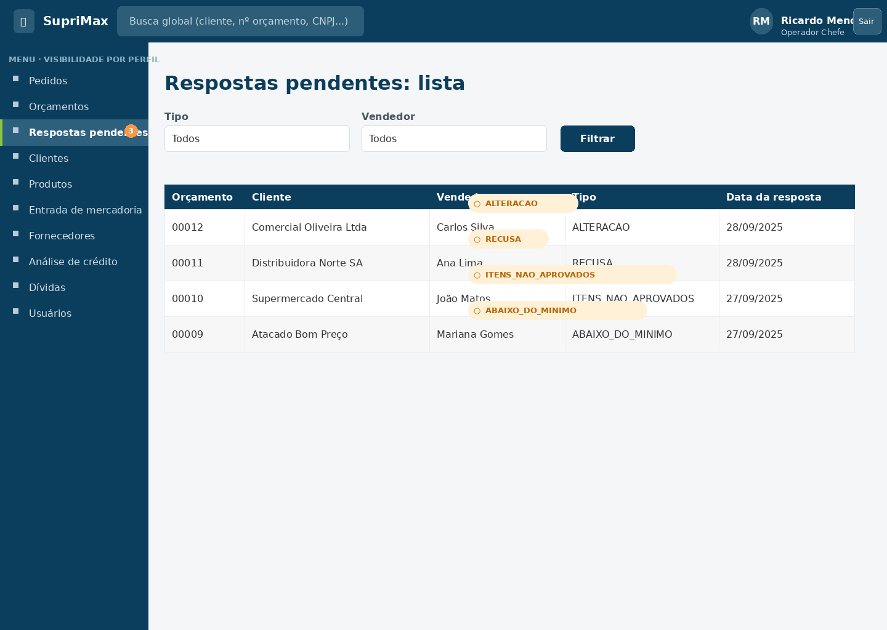

Figura 10.9 — Tela 9 (UC21 – Respostas pendentes: lista): exemplo visual.

### 10.6.10 Tela 10 – UC21 – Tratar resposta e nova versão

Reestruturação do orçamento a partir da resposta. A coluna esquerda mostra o orçamento original (situação de cada item, cotado × aprovado, valores recalculados pela faixa e a justificativa do vendedor, que pode estar vazia). A coluna direita traz a nova versão em rascunho, com os itens copiados.

- Itens não alterados recebem o selo “Aprovação herdada”; cada item pode ser editado ou removido, e alterar a quantidade ou o item remove o selo.
- Aviso: “A nova versão exige a confirmação do cliente”.
- Ações: Emitir nova versão (verde; número novo e validade de 30 dias), Marcar como tratada sem nova versão (usada em recusa) e Cancelar rascunho.
- Total abaixo do mínimo: alerta laranja e emissão desabilitada. Antes de emitir, modal informa que o orçamento original passará a SUBSTITUIDO.

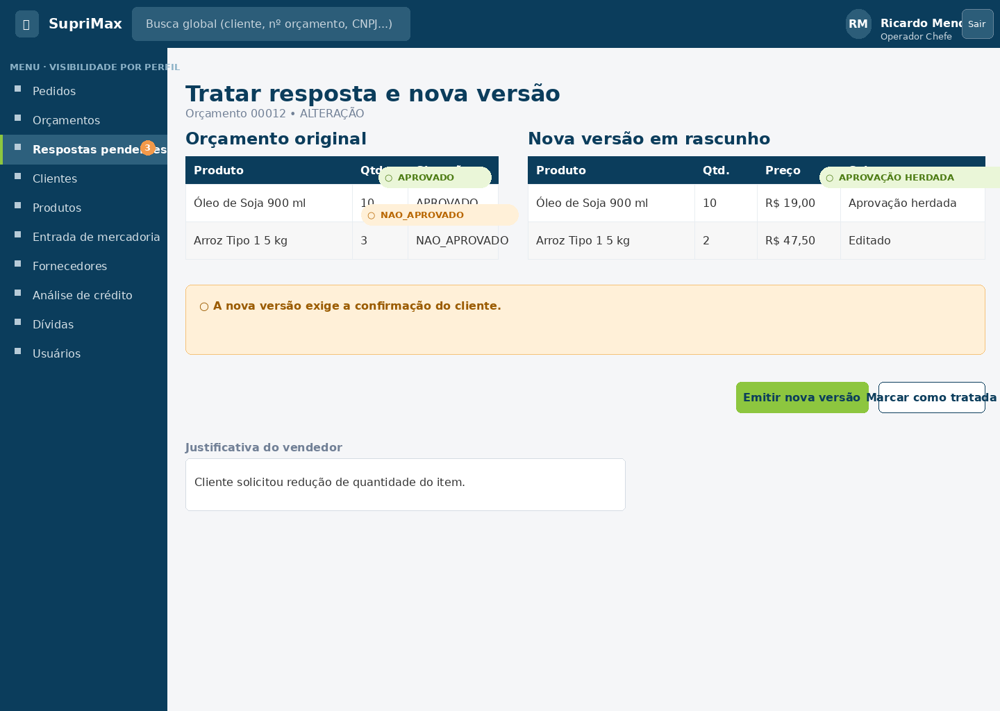

Figura 10.10 — Tela 10 (UC21 – Tratar resposta e nova versão): exemplo visual.

### 10.6.11 Tela 11 – UC07 – Análise de crédito

Registro da análise de crédito pelo fiscal. Mostra os dados do cliente e da compra, o checklist dos seis documentos (contrato social, balanço de lucro, comprovante de endereço, documento do proprietário, notas fiscais das últimas cinco compras e referências comerciais), cada um com status e data de recebimento, e o aviso LGPD.

- Resultado registrado como Aprovado ou Reprovado.
- Reprovado: a tela apresenta a condição alternativa de 50% adiantado + 50% após a entrega.

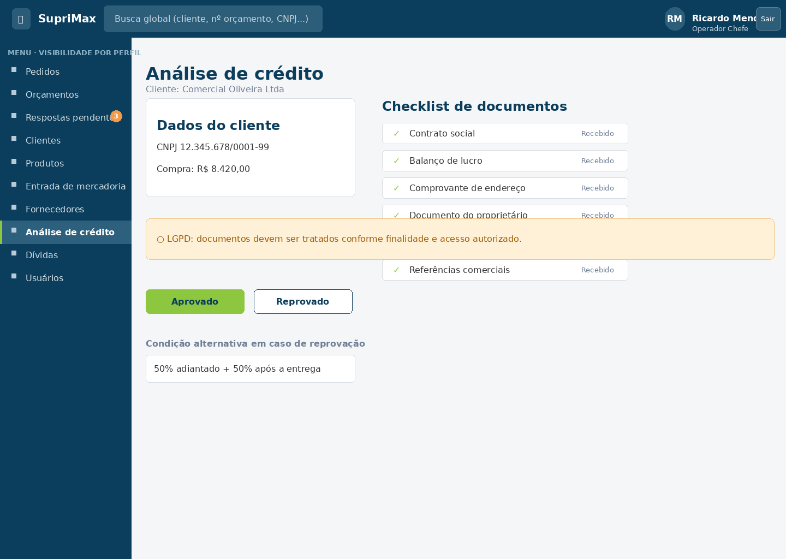

Figura 10.11 — Tela 11 (UC07 – Análise de crédito): exemplo visual.

### 10.6.12 Tela 12 – UC23 – Dívidas

Gestão das dívidas dos clientes pelo perfil Financeiro. A lista mostra cliente, valor da dívida, vencimento original, status, data de renegociação, valor pago e data de protesto, e há formulário para registrar dívida e renegociação.

- Alerta laranja quando o valor pago for inferior a 50% da dívida.

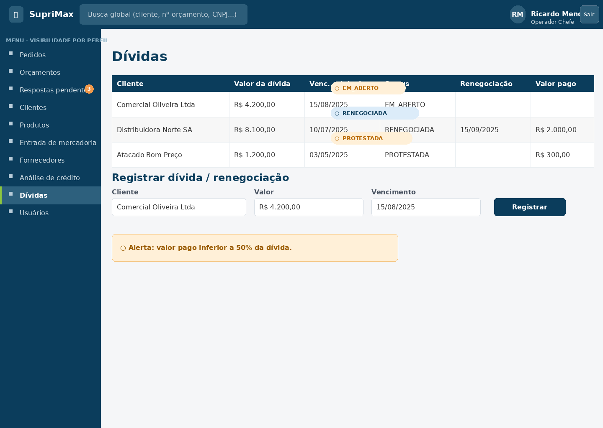

Figura 10.12 — Tela 12 (UC23 – Dívidas): exemplo visual.

### 10.6.13 Tela 13 – UC04 – Produtos: cadastro

Cadastro de produtos. Campos: código interno, descrição, NCM (opcional), EAN (opcional), categoria (opcional) e ativo. Por variação: marca, tamanho/embalagem e quantidade em estoque; faixas de preço (quantidade mínima e preço unitário) e fardos (quantidade de unidades e preço fixo).

- Faixas de preço e fardos só podem ser alterados pelo operador chefe.

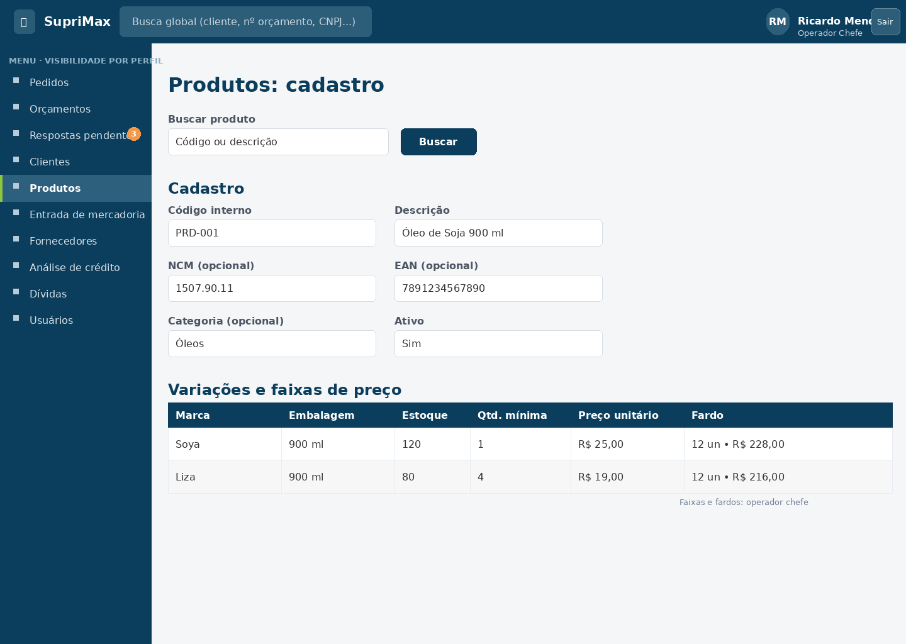

Figura 10.13 — Tela 13 (UC04 – Produtos: cadastro): exemplo visual.

### 10.6.14 Tela 14 – UC24 – Ajuste de estoque

Ajuste do estoque físico pelo operador chefe. Busca a variação e mostra saldo físico, reservado e disponível. O ajuste informa a quantidade a somar ou subtrair e o Motivo, obrigatório.

- Histórico de movimentações (ENTRADA, BAIXA, AJUSTE, ESTORNO), com data, usuário e quantidade.
- Bloqueio laranja quando o ajuste deixaria o físico abaixo do reservado.

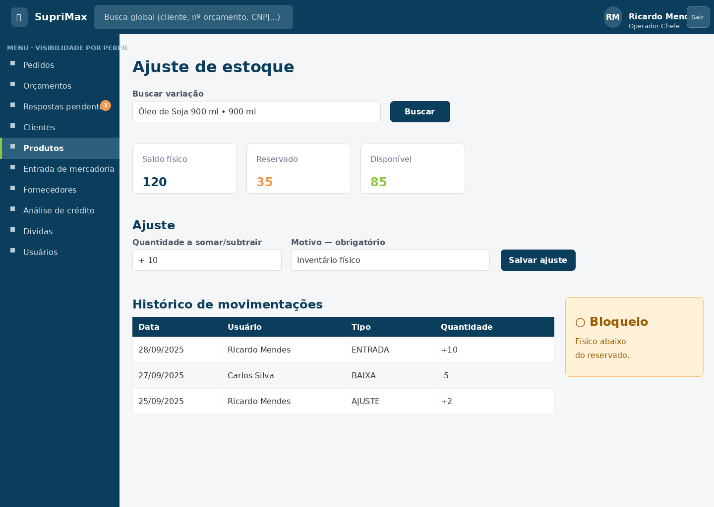

Figura 10.14 — Tela 14 (UC24 – Ajuste de estoque): exemplo visual.

### 10.6.15 Tela 15 – UC04 – Entrada de mercadoria

Registro da entrada de mercadoria. Campos: fornecedor, variação, nº da cotação de compra, quantidade comprada e quantidade informada.

- Divergência entre quantidade comprada e informada: alerta laranja e botão Salvar bloqueado.
- Liberação: modal “Liberação por operador chefe”, com usuário e senha próprios.

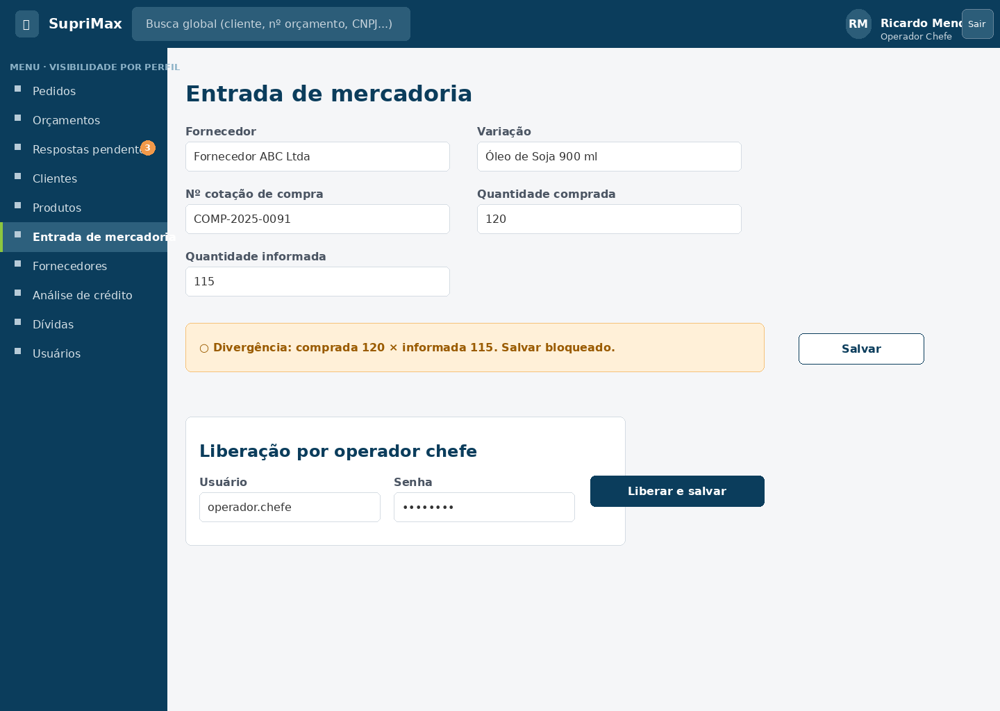

Figura 10.15 — Tela 15 (UC04 – Entrada de mercadoria): exemplo visual.

### 10.6.16 Tela 16 – UC22 – Fornecedores

Lista de fornecedores cadastrados e cadastro mínimo: CNPJ, razão social, nome do contato, telefone e e-mail.

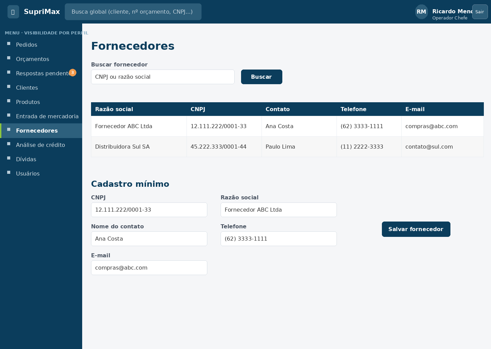

Figura 10.16 — Tela 16 (UC22 – Fornecedores): exemplo visual.

### 10.6.17 Tela 17 – UC25 – Usuários

Gestão de usuários pelo operador chefe. A lista mostra usuário, e-mail, perfil (VENDEDOR, OPERADOR, OPERADOR_CHEFE, FISCAL, FINANCEIRO, GESTOR) e status (ATIVO, INATIVO); o formulário pede usuário, e-mail e perfil.

- Inativação de vendedor com clientes na carteira: modal solicitando o novo vendedor responsável.

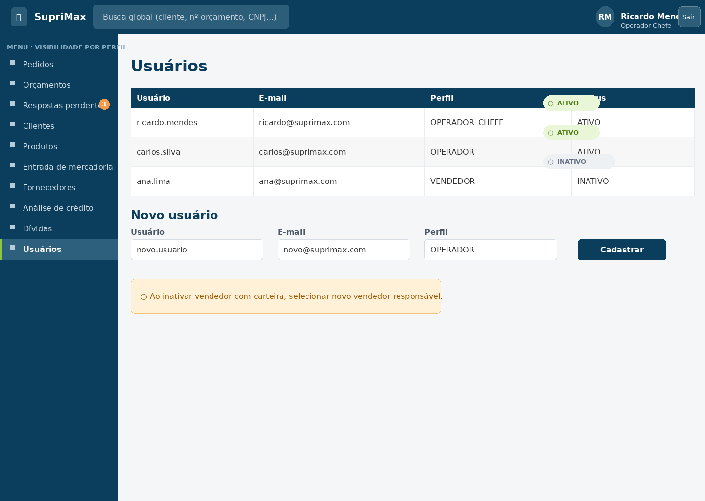

Figura 10.17 — Tela 17 (UC25 – Usuários): exemplo visual.

### 10.6.18 Tela 18 – Componentes e estados

Biblioteca dos estados reutilizáveis: botões (primário, secundário, confirmação e desabilitado), badges de todos os status, selo Aprovação herdada, alertas laranja com ícone e texto, campos (normal, foco, erro e opcional), tabela (cabeçalho petróleo, zebra e alinhamento numérico), modal (título, conteúdo e ações à direita), skeleton e tela vazia com orientação da próxima ação.

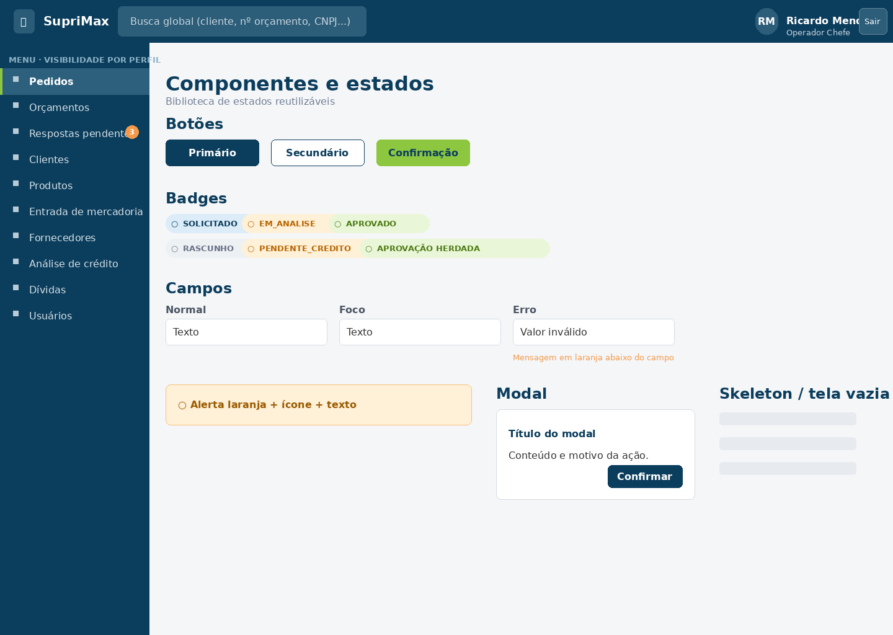

Figura 10.18 — Tela 18 (Componentes e estados): exemplo visual.

## 10.7 Comportamentos transversais

| **Situação** | **Comportamento da tela** |
|---|---|
| **Bloqueio de ação** | O botão fica desabilitado e um alerta laranja, com ícone e texto, explica o motivo. Casos: total abaixo do mínimo (montagem e nova versão), variação sem estoque, PENDENTE_CREDITO, dívida em aberto, divergência na entrada de mercadoria, ajuste que deixa o físico abaixo do reservado e cadastro sem aceite LGPD. |
| **Orçamento emitido** | É somente leitura. A única forma de alterar é criar uma nova versão pelo tratamento da resposta (tela 10); o original passa a SUBSTITUIDO. |
| **Motivos e justificativas** | Obrigatórios: motivo da negativa do pedido e motivo do ajuste de estoque. Opcional: justificativa do cancelamento do orçamento, que aceita campo vazio. |
| **Confirmação em modal** | Ações com efeito sobre outro registro pedem confirmação: negar pedido, cancelar orçamento, substituir o original, liberar divergência e trocar o vendedor responsável. |
| **Resiliência** | Em queda de conexão, a alteração em andamento fica em cache local e é reenviada ao restabelecer a conexão; a tela só se atualiza depois da leitura confirmada do banco (RNF06). |
| **Formatos** | Valores em R$ 0.000,00, alinhados à direita; datas no padrão brasileiro; nenhum texto abaixo de 12 px. |
| **Estados de dados** | Skeleton durante o carregamento e tela vazia com orientação da próxima ação, como no CNPJ não encontrado. |

## 10.8 Critérios de conformidade

Uma tela está conforme quando:

- tem o nome exato indicado na seção 10.6 e o tamanho de referência de 1440 × 1024 px, em português do Brasil;
- respeita a estrutura global (barra superior e menu lateral, exceto no login) e a visibilidade por perfil;
- apresenta somente os campos e as funcionalidades especificados, com os rótulos e os valores de status literais;
- aplica a tipografia, a paleta e os componentes das seções 7 e 8, sem usar vermelho;
- representa cada estado e cada bloqueio com ícone e texto, com contraste mínimo de 4,5:1;
- não introduz elementos de BI, do aplicativo mobile nem funcionalidades não especificadas.
