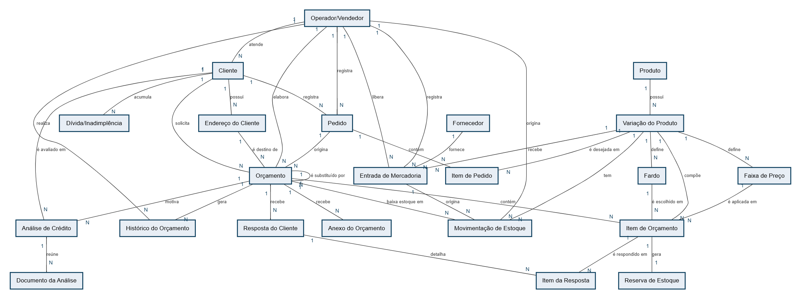
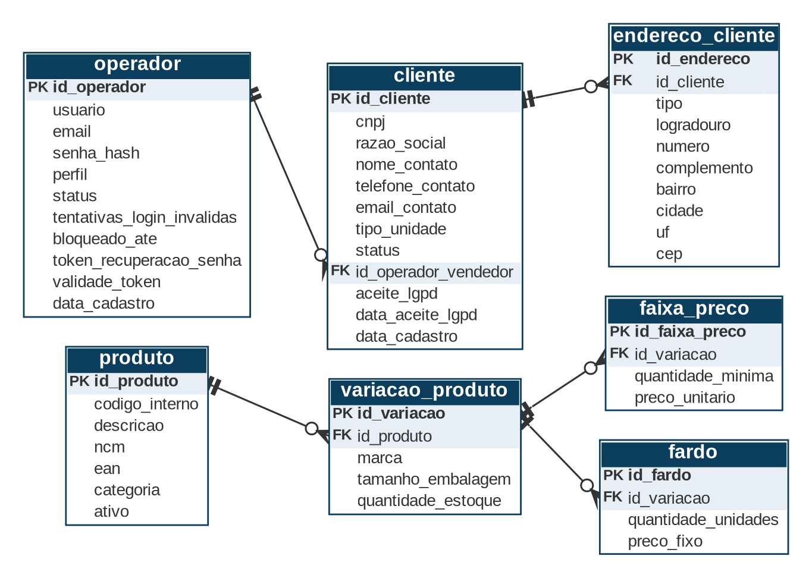
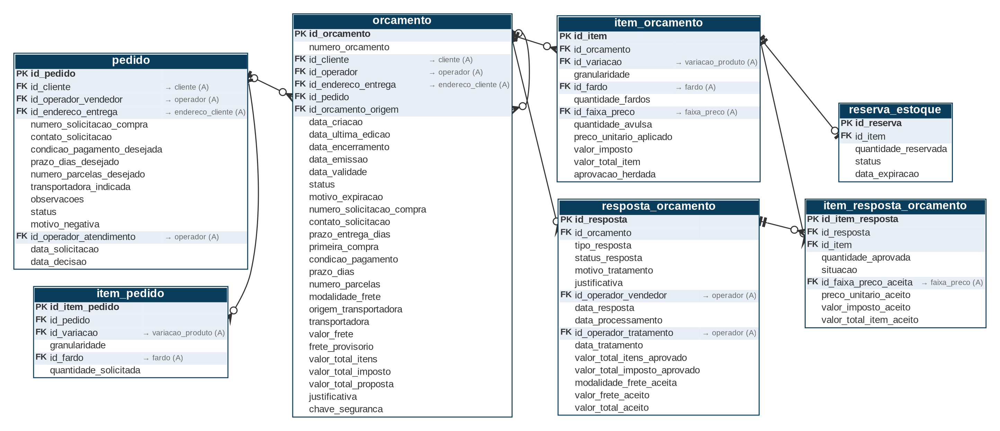
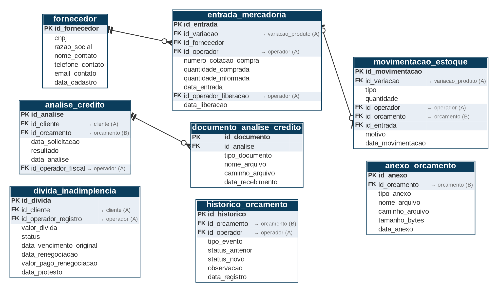

# 13. Banco de Dados Compartilhado

Esta seção documenta o modelo de dados do banco único compartilhado pelos três sistemas. Conteúdo referente somente ao Sistema 2 (Sistema de Cotação Web): a modelagem dos Sistemas 1 e 3 e a integração entre os sistemas dependem dos respectivos grupos (seção 12.9).

## 13.1 Escopo e integração

O Sistema 2 cobre o processo de cotação da SupriMax: o operador analisa os pedidos registrados pelo Sistema 1, consulta ou cadastra o cliente (B2B), monta um orçamento com produtos, marcas, quantidades e forma de compra, e o sistema aplica as regras comerciais de faturamento mínimo, análise de crédito, inadimplência, frete e imposto antes de emitir o documento final. Ficam fora do escopo o fluxo de reposição junto ao departamento de compras e a construção das telas e indicadores do Painel Gerencial (Sistema 3), que apenas consome dados agregados produzidos aqui.

Integração: o Sistema 1 registra pedidos (pedido e item_pedido) no banco compartilhado; o Sistema 2 os analisa e, aprovando o pedido, emite o orçamento, que o Sistema 1 exibe ao vendedor. O cliente responde item a item pelo mesmo canal: o Sistema 1 grava a resposta como PENDENTE (resposta_orcamento) e o Sistema 2 a processa, recalculando os itens aprovados; o orçamento só é aceito quando todos os itens estão aprovados. O Sistema 3 consome, por consulta, os indicadores agregados de orçamentos abertos, fechados, recusados e faturamento do dia/mês, sem tabela própria.

## 13.2 Modelagem

A modelagem segue a notação de Chen simplificada para o modelo conceitual e a notação pé-de-galinha para o diagrama entidade-relacionamento (ER) do modelo lógico, com nomes de tabelas e colunas em snake_case. A Figura 4 apresenta o diagrama conceitual, com entidades, relacionamentos e cardinalidades (1 ou N em cada extremidade). A Figura 5 apresenta o diagrama ER do modelo lógico em três recortes (5a, 5b e 5c), que juntos reúnem as vinte e duas tabelas e todas as suas colunas; a sigla PK indica a chave primária e a sigla FK, a chave estrangeira. As figuras estão em páginas no formato paisagem, para preservar a legibilidade.

Figura 4 — Diagrama conceitual do Sistema 2 (entidades e cardinalidades).

Leitura do diagrama (Figura 5). As tabelas faixa_preco e fardo derivam de uma mesma variação e representam as duas formas de compra: avulsa (por faixa de quantidade) e fechada (por pacote). A tabela item_orcamento referencia no máximo uma delas por linha, conforme a coluna granularidade, e gera, na emissão do orçamento, uma linha em reserva_estoque (relação 1:1), que reserva o saldo físico da variação. A relação conceitual muitos-para-muitos entre Orçamento e Variação do Produto é resolvida pela entidade associativa Item de Orçamento.

Legenda: PK = chave primária; FK = chave estrangeira. Barra dupla = “exatamente um”; barra com círculo = “zero ou um”; pé-de-galinha com círculo = “zero ou muitos” (lado da chave estrangeira). As linhas partem da tabela referenciada e chegam à tabela que contém a chave estrangeira. Chaves estrangeiras para tabelas de outro recorte não têm linha: aparecem em cinza na própria linha da coluna, com a letra do recorte (por exemplo, → cliente (A)).

Figura 5a — Diagrama ER do modelo lógico do Sistema 2, recorte A: Cadastros e catálogo de produtos.

Recorte A — Cadastros e catálogo de produtos. Reúne operador, cliente e endereco_cliente (cadastros de quem opera o sistema e de quem compra) e produto, variacao_produto, faixa_preco e fardo (catálogo, com as duas formas de compra: avulsa, por faixa de quantidade, e fechada, por pacote).

Figura 5b — Diagrama ER do modelo lógico do Sistema 2, recorte B: Pedido, orçamento e resposta do cliente.

Recorte B — Pedido, orçamento e resposta do cliente. O pedido registrado pelo Sistema 1 (pedido e item_pedido) origina o orçamento (orcamento, item_orcamento e reserva_estoque); a resposta do cliente fica em resposta_orcamento e item_resposta_orcamento. O auto-relacionamento id_orcamento_origem liga uma nova versão ao orçamento original.

Figura 5c — Diagrama ER do modelo lógico do Sistema 2, recorte C: Estoque, crédito, dívida e histórico.

Recorte C — Estoque, crédito, dívida e histórico. Reúne fornecedor, entrada_mercadoria e movimentacao_estoque (entradas, baixas e ajustes do estoque físico), analise_credito e documento_analise_credito, divida_inadimplencia, historico_orcamento e anexo_orcamento.

## 13.3 Entidades do Sistema 2

O modelo é composto por vinte e duas entidades:

| **Entidade** | **Observação** |
|---|---|
| Operador/Vendedor | Usuário em qualquer perfil (vendedor, operador, operador chefe, fiscal, financeiro ou gestor): login, bloqueio após tentativas inválidas e recuperação de senha. |
| Cliente | Cliente B2B por CNPJ; vinculado a um vendedor responsável (carteira de clientes). |
| Endereço do Cliente | Um ou mais endereços/locais de entrega por cliente. |
| Produto | Código interno, descrição e NCM. |
| Variação do Produto | Marca e tamanho/embalagem; item de estoque físico independente. |
| Faixa de Preço | Preço por faixa de quantidade, para venda avulsa da variação. |
| Fardo | Preço fixo por pacote fechado da variação. |
| Orçamento | Cabeçalho do orçamento: número, validade, status, condições, vínculo com o pedido e com a versão original. |
| Item de Orçamento | Linha do orçamento, por fardo fechado ou por faixa avulsa. |
| Reserva de Estoque | Reserva de saldo físico criada, na emissão, para cada item de orçamento (1:1); baixada no aceite. |
| Anexo do Orçamento | Descritivos técnicos e materiais de apoio do orçamento. |
| Análise de Crédito | Resultado da análise de crédito do cliente. |
| Documento da Análise | Documentos recebidos para a análise de crédito. |
| Dívida/Inadimplência | Dívida do cliente, com renegociação e protesto. |
| Histórico do Orçamento | Histórico de status e de follow-up do vendedor. |
| Entrada de Mercadoria | Conferência de entrada, com liberação de divergência. |
| Fornecedor | Quem fornece produtos à SupriMax; cadastro mínimo usado na entrada de mercadoria. |
| Pedido | Pedido de orçamento registrado pelo vendedor no Sistema 1, com a configuração desejada pelo cliente; analisado no Sistema 2 (aprovado ou negado). |
| Item de Pedido | Produto desejado no pedido: variação, granularidade e quantidade. |
| Resposta do Cliente | Resposta ao orçamento emitido (aprovação por item, recusa ou alteração), registrada como PENDENTE pelo Sistema 1 e processada pelo Sistema 2. |
| Item da Resposta | Quantidade aprovada por item do orçamento e valores recalculados na consolidação. |
| Movimentação de Estoque | Histórico de entradas, baixas no aceite, ajustes e estornos do estoque físico. |

**Relacionamentos e cardinalidades**

Todos os relacionamentos são do tipo um para muitos (1:N), exceto Item de Orçamento – Reserva de Estoque, que é 1:1. A relação conceitual muitos-para-muitos entre Orçamento e Variação do Produto é resolvida pela entidade associativa Item de Orçamento.

| **Entidade A** | **Relacionamento** | **Entidade B** | **Observação** |
|---|---|---|---|
| Operador/Vendedor | atende (1:N) | Cliente | Vendedor responsável pela carteira; cliente pertence a um único vendedor. |
| Cliente | possui (1:N) | Endereço do Cliente | Um ou mais endereços/locais de entrega. |
| Cliente | solicita (1:N) | Orçamento | Um cliente pode ter vários orçamentos. |
| Cliente | acumula (1:N) | Dívida/Inadimplência | Uma dívida em aberto e não renegociada bloqueia nova cotação. |
| Operador/Vendedor | elabora (1:N) | Orçamento | Operador/vendedor responsável pelo orçamento. |
| Endereço do Cliente | é destino de (1:N) | Orçamento | Local de entrega escolhido; participação opcional. |
| Orçamento | contém (1:N) | Item de Orçamento | Um orçamento tem um ou mais itens. |
| Produto | possui (1:N) | Variação do Produto | Várias marcas e tamanhos/embalagens por produto. |
| Variação do Produto | define (1:N) | Faixa de Preço | Faixas de preço para venda avulsa. |
| Variação do Produto | define (1:N) | Fardo | Tipos de fardo, cada um com preço próprio. |
| Variação do Produto | compõe (1:N) | Item de Orçamento | Variação cotada em cada item. |
| Fardo | é escolhido em (1:N) | Item de Orçamento | Preenchido só quando granularidade = FARDO. |
| Faixa de Preço | é aplicada em (1:N) | Item de Orçamento | Preenchido só quando granularidade = AVULSO. |
| Item de Orçamento | gera (1:1) | Reserva de Estoque | Toda linha do orçamento gera uma reserva (1:1). |
| Orçamento | recebe (1:N) | Anexo do Orçamento | Descritivos técnicos e materiais de apoio. |
| Cliente | é avaliado em (1:N) | Análise de Crédito | Um cliente pode ter várias análises ao longo do tempo. |
| Orçamento | motiva (1:N) | Análise de Crédito | Participação opcional: análise pode não estar ligada a uma cotação. |
| Análise de Crédito | reúne (1:N) | Documento da Análise | Seis tipos de documento exigidos; pode haver mais de um por tipo. |
| Orçamento | gera (1:N) | Histórico do Orçamento | Cada mudança de status gera um registro. |
| Operador/Vendedor | realiza (1:N) | Histórico do Orçamento | Participação opcional: eventos automáticos não têm operador. |
| Variação do Produto | recebe (1:N) | Entrada de Mercadoria | Toda entrada é de uma variação específica. |
| Operador/Vendedor | registra (1:N) | Entrada de Mercadoria | Operador que registrou a entrada. |
| Operador/Vendedor | libera (1:N) | Entrada de Mercadoria | Operador chefe que liberou a divergência; participação opcional. |
| Cliente | registra (1:N) | Pedido | Pedido feito pelo vendedor para o cliente. |
| Operador/Vendedor | registra (1:N) | Pedido | Vendedor que registrou o pedido no Sistema 1. |
| Pedido | contém (1:N) | Item de Pedido | Produtos desejados no pedido. |
| Variação do Produto | é desejada em (1:N) | Item de Pedido | Variação desejada em cada item do pedido. |
| Pedido | origina (1:N) | Orçamento | Orçamento montado a partir do pedido; participação opcional. |
| Orçamento | é substituído por (1:N) | Orçamento | Auto-relacionamento: a nova versão aponta para o orçamento original; participação opcional. |
| Orçamento | recebe (1:N) | Resposta do Cliente | Respostas sucessivas do vendedor; cada resposta traz o estado de todos os itens e parte do estado da anterior. |
| Resposta do Cliente | detalha (1:N) | Item da Resposta | Uma linha por item do orçamento respondido. |
| Item de Orçamento | é respondido em (1:N) | Item da Resposta | Um item pode constar em mais de uma resposta. |
| Fornecedor | fornece (1:N) | Entrada de Mercadoria | Fornecedor da mercadoria recebida. |
| Variação do Produto | tem (1:N) | Movimentação de Estoque | Toda movimentação é de uma variação específica. |
| Operador/Vendedor | origina (1:N) | Movimentação de Estoque | Usuário que ajustou ou registrou; participação opcional (baixa automática no aceite). |
| Orçamento | baixa estoque em (1:N) | Movimentação de Estoque | Baixa no aceite; participação opcional. |
| Entrada de Mercadoria | origina (1:N) | Movimentação de Estoque | Entrada confirmada; participação opcional. |

## 13.4 Regras de negócio implementadas no banco

Onde uma restrição CHECK não alcança outra tabela, a regra é implementada por gatilho (trigger) ou pela camada de serviço, sempre mediada pelo proxy único de acesso ao banco.

| **Regra** | **Implementação** |
|---|---|
| Numeração do orçamento | Sequence própria, crescente e sem limite superior (BIGINT), UNIQUE em numero_orcamento; o número é obtido na emissão e o campo é nulo em rascunho. Única e crescente, sem vínculo com a data; lacunas são admitidas, pois a sequence do banco não garante ausência de buracos. |
| Disponibilidade de estoque | CHECK quantidade_estoque ≥ 0 em variacao_produto. Gatilho em reserva_estoque impede reservar mais do que o saldo disponível (físico − reservas vigentes) no momento da emissão; o rascunho não reserva. |
| Divergência na entrada de mercadoria | CHECK em entrada_mercadoria: quantidade_comprada = quantidade_informada, ou id_operador_liberacao e data_liberacao preenchidos; gatilho confirma perfil OPERADOR_CHEFE do liberador. |
| Justificativa de cancelamento/recusa | A justificativa é opcional em orcamento e em resposta_orcamento (aceita nulo ou vazio); não há tamanho mínimo. |
| Consentimento LGPD | aceite_lgpd NN com CHECK = TRUE e data_aceite_lgpd NN, em cliente. |
| Integridade do endereço de entrega | Gatilho em orcamento valida, na emissão, que id_endereco_entrega pertence ao mesmo id_cliente do orçamento; caso contrário, a emissão é rejeitada. |
| Chave de segurança do orçamento | UNIQUE em chave_seguranca; nula em rascunho, preenchida só na emissão. Gatilho torna o conteúdo do orçamento imutável depois da emissão; apenas status e campos de encerramento podem mudar. |
| Bloqueio de login | tentativas_login_invalidas incrementado a cada falha; ao atingir 3, gatilho grava bloqueado_ate (login bloqueado até esse instante) e zera o contador na próxima autenticação bem-sucedida. |
| Recuperação de senha | token_recuperacao_senha (UNIQUE) e validade_token gerados no pedido de redefinição; gatilho ou serviço invalida o token após o uso ou o vencimento. |
| Fardo fechado | CHECK em item_orcamento: quantidade_fardos inteira e maior que zero, preenchida só quando granularidade = FARDO; id_faixa_preco nulo nesse caso. |
| Faixa de preço avulsa | CHECK em item_orcamento: id_faixa_preco preenchido só quando granularidade = AVULSO; o serviço identifica a faixa pela quantidade total do item e copia o preço para preco_unitario_aplicado. |
| Integridade de fardo/faixa com a variação | CHECK/gatilho em item_orcamento garante que o id_fardo (quando FARDO) pertence à mesma id_variacao do item, e que o id_faixa_preco (quando AVULSO) também pertence à mesma id_variacao — evitando associar fardo ou faixa de uma variação diferente da cotada. |
| Ciclo da reserva de estoque | Reservas nascem CONFIRMADA na emissão; data_expiracao de reserva_estoque é copiada de orcamento.data_validade. Job periódico muda o status para EXPIRADA após essa data quando o orçamento não foi aceito. No ACEITO, a reserva passa a BAIXADA, com a baixa do estoque físico registrada em movimentacao_estoque; em cancelamento, recusa ou substituição do orçamento, passa a LIBERADA. |
| Cliente inadimplente | Gatilho em orcamento impede INSERT quando o cliente tem divida_inadimplencia com status = EM_ABERTO ou PROTESTADA. A liberação só ocorre quando o status muda para RENEGOCIADA (valor_pago_renegociacao ≥ 50%) ou QUITADA. |
| Renegociação de dívida | CHECK em divida_inadimplencia: valor_pago_renegociacao ≥ 0,5 × valor_divida quando status = RENEGOCIADA. |
| Protesto por atraso | Job periódico muda status para PROTESTADA e grava data_protesto quando já se passaram mais de 60 dias corridos entre data_vencimento_original e a data atual, sem renegociação. |
| Imposto de 18% e total do item | CHECK em item_orcamento: valor_imposto = ROUND(base × 0,18; 2) e valor_total_item = base + valor_imposto, em que base é quantidade_fardos × preco_unitario_aplicado ou quantidade_avulsa × preco_unitario_aplicado, conforme a granularidade. Camada de proteção redundante: a fonte oficial desta regra é o módulo de cálculo (modulo-calculo-suprimax.docx); o CHECK apenas impede gravação divergente por eventual falha do backend. |
| Validade de 30 dias | CHECK em orcamento: quando emitido, data_validade = data_emissao + 30 dias; data_emissao e data_validade são nulas em rascunho. Camada de proteção redundante: a fonte oficial desta regra também é o módulo de cálculo; o CHECK apenas impede gravação divergente por eventual falha do backend. |
| Senha criptografada | Somente o hash da senha é gravado em senha_hash. |
| Condições comerciais da cotação | CHECK em orcamento: BOLETO exige prazo_dias em 10, 15, 20, 28 ou 30, e PARCELADO exige numero_parcelas maior que 1 (nos demais casos ambos são nulos); modalidade_frete = CIF não admite origem_transportadora nem valor_frete; frete_provisorio = TRUE exige valor_frete nulo; valor_total_proposta = valor_total_itens + COALESCE(valor_frete, 0). |
| Duração do rascunho | Job periódico muda para EXPIRADO (motivo_expiracao = RASCUNHO) o orçamento RASCUNHO ou PENDENTE_CREDITO cuja data_ultima_edicao seja anterior a 30 dias, gravando data_encerramento; outro job apaga o rascunho EXPIRADO cuja data_encerramento seja anterior a 30 dias. Orçamentos emitidos nunca são apagados. |
| Versão do orçamento | id_orcamento_origem referencia orcamento (auto-relacionamento); ao emitir a nova versão, gatilho muda o original para SUBSTITUIDO e libera suas reservas. |
| Resposta do cliente | tipo_resposta ITENS, RECUSA ou ALTERACAO; status_resposta PENDENTE, CONSOLIDADA, AGUARDA_OPERADOR ou TRATADA; motivo_tratamento (RECUSA, ALTERACAO, ITENS_NAO_APROVADOS ou ABAIXO_DO_MINIMO) preenchido quando AGUARDA_OPERADOR. Cada resposta traz todos os itens do orçamento (estado cumulativo); a última resposta processada define a situação atual. item_resposta_orcamento.quantidade_aprovada entre 0 e a quantidade cotada. O orçamento muda para ACEITO somente quando todos os itens da resposta estão APROVADO e o faturamento mínimo é atendido. |
| Itens do pedido | CHECK em item_pedido: id_fardo preenchido só quando granularidade = FARDO; quantidade_solicitada maior que zero. |
| Perfis de usuário | CHECK em operador.perfil: VENDEDOR, OPERADOR, OPERADOR_CHEFE, FISCAL, FINANCEIRO ou GESTOR; gatilho impede inativar vendedor com clientes na carteira sem indicar novo responsável. |
| Movimentação de estoque | Gatilho em movimentacao_estoque atualiza variacao_produto.quantidade_estoque; CHECK: AJUSTE exige motivo; o estoque físico não pode ficar abaixo do total das reservas CONFIRMADA. |
| Aprovação herdada | item_orcamento.aprovacao_herdada só pode ser TRUE quando o orçamento tem id_orcamento_origem; alterar a quantidade ou a variação do item em rascunho a redefine para FALSE. |
| Pedido negado | CHECK em pedido: motivo_negativa obrigatório quando status = NEGADO. |

## 13.5 Segurança, auditoria e desempenho

**Autenticação e controle de acesso.** A senha do operador é armazenada apenas como hash (coluna senha_hash), nunca em texto puro. Após três tentativas de login inválidas consecutivas (tentativas_login_invalidas), a conta é bloqueada temporariamente (bloqueado_ate); a recuperação de senha usa um token de uso único com validade (token_recuperacao_senha, validade_token), enviado por e-mail.

**Acesso ao banco.** Nenhum componente acessa o banco diretamente: todo acesso do backend dos três sistemas passa por um proxy único, que valida e serializa as requisições concorrentes. Essa mediação cobre também as tabelas específicas do Sistema 2.

**Dados sensíveis (LGPD).** O cadastro do cliente registra o aceite da cláusula LGPD com data e hora (aceite_lgpd, data_aceite_lgpd). Os documentos recebidos para a análise de crédito (documento_analise_credito) contêm dados sensíveis do proprietário da empresa cliente — contrato social, documento pessoal — e ficam fora do banco (apenas o caminho é armazenado), exigindo controle de acesso próprio no armazenamento de arquivos.

**Auditoria.** historico_orcamento registra toda mudança de status da cotação e cada follow-up do vendedor, com autor e data. entrada_mercadoria funciona como log das liberações de divergência por operador chefe (quem liberou e quando). A chave de segurança (chave_seguranca) permite validar a autenticidade de um orçamento emitido e, associada ao gatilho de imutabilidade, impede alteração de cotação já emitida sem gerar nova versão.

**Desempenho.** A busca de cliente por CNPJ e o cálculo do orçamento precisam responder rapidamente. A tabela a seguir lista os índices recomendados, além das chaves primárias e estrangeiras, que já recebem índice automaticamente na maioria dos SGBDs.

| **Tabela** | **Índice sugerido** | **Motivo** |
|---|---|---|
| cliente | cnpj (já UNIQUE) | Suporta a busca do RF04, feita a cada início de cotação. |
| orcamento | numero_orcamento (já UNIQUE); id_cliente; status | Buscas por número, por cliente e listagens por status (cotações em aberto). |
| item_orcamento | id_orcamento | Montagem do orçamento completo a partir da cotação. |
| variacao_produto | id_produto; (marca, tamanho_embalagem) | Busca e filtro de produtos por marca e variação. |
| historico_orcamento | id_orcamento, data_registro | Consulta do follow-up e do histórico. |
| divida_inadimplencia | id_cliente, status | Verificação de inadimplência antes de abrir cotação. |
| pedido | status; id_cliente | Fila de pedidos SOLICITADO lida pelo Sistema 2. |
| resposta_orcamento | id_orcamento, status_resposta | Busca das respostas PENDENTE pelo Sistema 2. |
| movimentacao_estoque | id_variacao, data_movimentacao | Consulta do histórico de estoque por variação. |

**Testes recomendados.** Recomenda-se, no mínimo, testar:

- Concorrência na geração do numero_orcamento, garantindo ausência de duplicidade sob inserções simultâneas.
- O bloqueio de login após a terceira tentativa e a expiração do token de recuperação.
- A rejeição de item sem saldo disponível (físico − reservas).
- A rejeição de item com granularidade e colunas de fardo/faixa inconsistentes.
- O bloqueio de nova cotação para cliente com dívida em aberto e sua liberação após renegociação com pelo menos 50% pago.
- A expiração automática de reserva_estoque na data de validade do orçamento.
- O fechamento por item: recálculo do preço avulso por faixa e do imposto por linha; aceite somente com todos os itens aprovados e o faturamento mínimo atendido sobre o total aceito.
- Dois operadores tentando assumir o mesmo pedido: apenas um o passa a EM_ANALISE.
- A expiração do rascunho e do pendente de crédito após 30 dias sem edição, o apagamento do rascunho expirado 30 dias depois e a ausência de reserva de estoque no rascunho.

## 13.6 Uso compartilhado entre os três sistemas

A tabela abaixo indica, para cada tabela do Sistema 2, o uso previsto pelos Sistemas 1 e 3 — inferido da documentação de requisitos.

Conteúdo referente somente ao Sistema 2: o uso previsto pelos Sistemas 1 e 3 é uma proposta derivada da documentação de requisitos e não foi validado com os respectivos grupos.

| **Tabela(s)** | **Sistema 1 (mobile)** | **Sistema 2 (cotação)** | **Sistema 3 (painel)** |
|---|---|---|---|
| operador | Login unificado | Login, perfis e gestão de usuários | Login unificado |
| cliente, endereco_cliente | Consulta ao abrir pedido | Cadastro e consulta | Consulta |
| produto, variacao_produto, faixa_preco, fardo | Consulta de preços e disponibilidade | Cadastro e consulta | Controle de estoque e indicadores |
| orcamento, item_orcamento, reserva_estoque, historico_orcamento | Lê o orçamento pronto; registra o follow-up | Monta, edita, emite e versiona | Lê para indicadores (RF17) |
| anexo_orcamento, analise_credito, documento_analise_credito | Consulta o resultado | Cadastro e consulta | — |
| divida_inadimplencia | — | Consulta ao abrir orçamento; cadastro pelo financeiro | Indicadores de inadimplência |
| entrada_mercadoria | — | Registra entradas | Controle de estoque |
| fornecedor | — | Cadastro e consulta | — |
| pedido, item_pedido | Registra o pedido; lê o status e o motivo da negativa | Lista pedidos em aberto, analisa, aprova ou nega | — |
| resposta_orcamento, item_resposta_orcamento | Registra a resposta pendente; lê o último dado gravado | Processa, recalcula e trata as respostas | Lê para indicadores (RF17) |
| movimentacao_estoque | — | Registra entradas, ajustes e baixas | Controle de estoque |

## 13.7 Dicionário de dados completo

Este item reúne o dicionário de dados das vinte e duas tabelas do Sistema 2, com todas as colunas, tipos, restrições e chaves estrangeiras.

Uma versão em planilha deste dicionário, para consulta e filtro, acompanha esta documentação no arquivo **Dicionario_de_Dados_SupriMax.xlsx** (abas Leia-me, Entidades, Colunas e Chaves Estrangeiras). Ao alterar o schema, documento e planilha devem ser atualizados em conjunto.

Siglas das restrições: PK (chave primária), FK (chave estrangeira — referências na seção 13.7.23), UK (unicidade), NN (não nulo) e CK (restrição de verificação). Colunas sem NN aceitam nulo, exceto as chaves primárias.

### 13.7.1 Tabela operador

Usuário do sistema em qualquer perfil (vendedor, operador, operador chefe, fiscal, financeiro ou gestor). Login unificado com os Sistemas 1 e 3; o vendedor responde por uma carteira de clientes.

| **Coluna** | **Tipo** | **Restrições** | **Descrição** |
|---|---|---|---|
| **id_operador** | INTEGER | PK | Identificador do operador (auto-incremento). |
| usuario | VARCHAR(50) | NN, UK | Nome de usuário usado no login. |
| email | VARCHAR(120) | NN, UK | E-mail do usuário; recebe o link de definição e de recuperação de senha. |
| senha_hash | VARCHAR(255) | NN | Senha armazenada de forma criptografada (RNF01). |
| perfil | VARCHAR(20) | NN, CK | VENDEDOR, OPERADOR, OPERADOR_CHEFE, FISCAL, FINANCEIRO ou GESTOR. |
| status | VARCHAR(7) | NN, CK | ATIVO ou INATIVO. Padrão: ATIVO. |
| tentativas_login_invalidas | SMALLINT | NN, CK | Contador de tentativas de login inválidas consecutivas; 0 a 3. Padrão: 0. |
| bloqueado_ate | TIMESTAMP |  | Momento até o qual o login fica bloqueado; nulo quando não há bloqueio ativo. |
| token_recuperacao_senha | VARCHAR(255) | UK | Token de redefinição de senha enviado por e-mail; nulo fora do fluxo de recuperação. |
| validade_token | TIMESTAMP |  | Data e hora limite de uso do token de recuperação; nula quando não há token ativo. |
| data_cadastro | TIMESTAMP | NN | Data e hora de criação da conta. Padrão: momento atual. |

### 13.7.2 Tabela cliente

Empresa cliente B2B, identificada por CNPJ. Cada cliente pertence a um único vendedor (carteira de clientes).

| **Coluna** | **Tipo** | **Restrições** | **Descrição** |
|---|---|---|---|
| **id_cliente** | INTEGER | PK | Identificador do cliente (auto-incremento). |
| cnpj | CHAR(14) | NN, UK | CNPJ, somente dígitos. |
| razao_social | VARCHAR(150) | NN | Razão social. |
| nome_fantasia | VARCHAR(150) |  | Nome fantasia; opcional, usado na busca por CNPJ, razão social ou nome fantasia (UC14). |
| nome_contato | VARCHAR(100) | NN | Nome do responsável/contato. |
| telefone_contato | VARCHAR(20) |  | Telefone de contato. |
| email_contato | VARCHAR(120) |  | E-mail de contato. |
| tipo_unidade | VARCHAR(6) | NN, CK | MATRIZ ou FILIAL. |
| status | VARCHAR(9) | NN, CK | ATIVO, INATIVO ou BLOQUEADO. Padrão: ATIVO. |
| id_operador_vendedor | INTEGER | FK, NN | Vendedor responsável pela carteira do cliente. |
| aceite_lgpd | BOOLEAN | NN, CK | Aceite da cláusula LGPD; só admite TRUE. |
| data_aceite_lgpd | TIMESTAMP | NN | Data e hora do aceite da cláusula LGPD. |
| data_cadastro | TIMESTAMP | NN | Data e hora do cadastro. Padrão: momento atual. |

### 13.7.3 Tabela endereco_cliente

Endereço cadastral ou local de entrega de um cliente (relação 1:N).

| **Coluna** | **Tipo** | **Restrições** | **Descrição** |
|---|---|---|---|
| **id_endereco** | INTEGER | PK | Identificador do endereço (auto-incremento). |
| id_cliente | INTEGER | FK, NN | Cliente dono do endereço. |
| tipo | VARCHAR(10) | NN, CK | CADASTRAL ou ENTREGA. |
| logradouro | VARCHAR(150) | NN | Rua, avenida etc. |
| numero | VARCHAR(10) | NN | Número (aceita 'S/N'). |
| complemento | VARCHAR(60) |  | Complemento. |
| bairro | VARCHAR(80) | NN | Bairro. |
| cidade | VARCHAR(80) | NN | Cidade. |
| uf | CHAR(2) | NN | Unidade da federação. |
| cep | CHAR(8) | NN | CEP, somente dígitos. |

### 13.7.4 Tabela produto

Item do catálogo, sem marca ou embalagem definidas. Compartilhado com os Sistemas 1 e 3.

| **Coluna** | **Tipo** | **Restrições** | **Descrição** |
|---|---|---|---|
| **id_produto** | INTEGER | PK | Identificador do produto (auto-incremento). |
| codigo_interno | VARCHAR(30) | NN, UK | Código interno do produto. |
| descricao | VARCHAR(200) | NN | Descrição do produto. |
| ncm | CHAR(8) |  | Classificação fiscal NCM; nulo quando não aplicável. |
| ean | VARCHAR(14) | UK | Código de barras (EAN/GTIN); opcional. |
| categoria | VARCHAR(60) |  | Categoria/departamento do produto (UC15); opcional. |
| ativo | BOOLEAN | NN | FALSE para produto descontinuado. Padrão: TRUE. |

### 13.7.5 Tabela variacao_produto

Combinação de marca e tamanho/embalagem de um produto; é o item de estoque físico independente. O preço não fica aqui: vem das Faixas de Preço (venda avulsa) ou dos Fardos (venda fechada).

| **Coluna** | **Tipo** | **Restrições** | **Descrição** |
|---|---|---|---|
| **id_variacao** | INTEGER | PK | Identificador da variação (auto-incremento). |
| id_produto | INTEGER | FK, NN | Produto ao qual a variação pertence. |
| marca | VARCHAR(60) | NN | Marca. |
| tamanho_embalagem | VARCHAR(40) | NN | Tamanho ou embalagem (ex.: 1 kg, 5 kg). |
| quantidade_estoque | INTEGER | NN, CK | Quantidade em estoque físico à pronta entrega; maior ou igual a zero. Padrão: 0. |

### 13.7.6 Tabela faixa_preco

Faixa de preço para venda avulsa de uma variação, por quantidade mínima (ex.: 1 a 3 un. = R$ 25,00; 4+ un. = R$ 19,00).

| **Coluna** | **Tipo** | **Restrições** | **Descrição** |
|---|---|---|---|
| **id_faixa_preco** | INTEGER | PK | Identificador da faixa (auto-incremento). |
| id_variacao | INTEGER | FK, NN | Variação à qual a faixa pertence. |
| quantidade_minima | INTEGER | NN, CK | Quantidade mínima para a faixa se aplicar; maior que zero. |
| preco_unitario | DECIMAL(12,2) | NN, CK | Preço unitário nessa faixa; maior ou igual a zero. |

### 13.7.7 Tabela fardo

Opção de venda em pacote fechado de uma variação. Uma variação pode ter mais de um tipo de fardo, cada um com preço próprio.

| **Coluna** | **Tipo** | **Restrições** | **Descrição** |
|---|---|---|---|
| **id_fardo** | INTEGER | PK | Identificador do fardo (auto-incremento). |
| id_variacao | INTEGER | FK, NN | Variação à qual o fardo pertence. |
| quantidade_unidades | INTEGER | NN, CK | Quantidade de unidades por fardo; maior que zero. |
| preco_fixo | DECIMAL(12,2) | NN, CK | Preço fixo do fardo; maior ou igual a zero. |

### 13.7.8 Tabela orcamento

Orçamento (cotação de venda) emitido a um cliente por um operador/vendedor, com versões e status (seção 4.6). O orçamento emitido é imutável; os valores aceitos ficam em resposta_orcamento.

| **Coluna** | **Tipo** | **Restrições** | **Descrição** |
|---|---|---|---|
| **id_orcamento** | INTEGER | PK | Identificador interno do orçamento (auto-incremento). |
| numero_orcamento | BIGINT | UK, CK | Número sequencial único e crescente (mínimo de 5 dígitos na exibição, sem limite superior), sem vínculo com a data. Vem de uma sequence e é atribuído na emissão; nulo em rascunho. |
| id_cliente | INTEGER | FK, NN | Cliente do orçamento. |
| id_operador | INTEGER | FK, NN | Operador (Sistema 2) responsável pelo orçamento. |
| id_endereco_entrega | INTEGER | FK | Local de entrega escolhido; opcional. |
| id_pedido | INTEGER | FK | Pedido do Sistema 1 que originou o orçamento; opcional. |
| id_orcamento_origem | INTEGER | FK | Orçamento original, quando este é uma nova versão criada por pedido de alteração; opcional. |
| data_criacao | TIMESTAMP | NN | Data e hora de criação do rascunho. Padrão: momento atual. |
| data_ultima_edicao | TIMESTAMP | NN | Data e hora da última edição; base da expiração de 30 dias do rascunho. Padrão: momento atual. |
| data_encerramento | TIMESTAMP |  | Data e hora em que o orçamento saiu de aberto (aceito, recusado, cancelado, substituído ou expirado); base do apagamento do rascunho expirado 30 dias depois. |
| data_emissao | DATE | CK | Data de emissão, definida na emissão; nula em rascunho. |
| data_validade | DATE | CK | Data de validade; igual à emissão + 30 dias; nula em rascunho. |
| status | VARCHAR(20) | NN, CK | RASCUNHO, PENDENTE_CREDITO, ABERTO, ALTERACAO_SOLICITADA, ACEITO, RECUSADO, CANCELADO, SUBSTITUIDO ou EXPIRADO (ver seção 4.6). Padrão: RASCUNHO. |
| motivo_expiracao | VARCHAR(10) | CK | Preenchido quando status = EXPIRADO: RASCUNHO (30 dias sem edição) ou VALIDADE (30 dias após a emissão). |
| numero_solicitacao_compra | VARCHAR(30) |  | Número da solicitação de compra do cliente. |
| contato_solicitacao | VARCHAR(100) |  | Contato específico do cliente vinculado ao orçamento. |
| prazo_entrega_dias | SMALLINT | CK | Prazo de entrega em dias, exibido no PDF; maior que zero. |
| primeira_compra | BOOLEAN | NN | TRUE quando é a primeira compra do cliente (pagamento 100% adiantado); definido pelo backend na abertura do orçamento, a partir do histórico de compras fechadas. Padrão: FALSE. |
| condicao_pagamento | VARCHAR(16) | CK | ADIANTADO_100, BOLETO, PARCELADO ou ADIANTADO_50_50 (crédito reprovado); nulo em rascunho. |
| prazo_dias | SMALLINT | CK | Prazo do boleto em dias corridos: 10, 15, 20, 28 ou 30; obrigatório quando condicao_pagamento = BOLETO e nulo nos demais casos. |
| numero_parcelas | SMALLINT | CK | Número de parcelas, maior que 1; obrigatório quando condicao_pagamento = PARCELADO e nulo nos demais casos. |
| modalidade_frete | VARCHAR(3) | CK | CIF (a partir de R$ 1.500,00 ou CIF contratual) ou FOB (abaixo de R$ 1.500,00); nulo em rascunho. |
| origem_transportadora | VARCHAR(9) | CK | SUPRIMAX (frete cotado pela SupriMax) ou CLIENTE (transportadora indicada pelo cliente); preenchido só quando modalidade_frete = FOB. |
| transportadora | VARCHAR(100) |  | Nome da transportadora, quando o frete FOB é cotado ou indicado; opcional. |
| valor_frete | DECIMAL(12,2) | CK | Valor do frete destacado no orçamento e na nota fiscal; maior ou igual a zero; nulo quando CIF, quando a transportadora é do cliente ou enquanto o frete não foi cotado. |
| frete_provisorio | BOOLEAN | NN | TRUE quando o frete FOB ainda não foi cotado com a transportadora; o orçamento sinaliza a provisoriedade (UC18, E3). Padrão: FALSE. |
| valor_total_itens | DECIMAL(12,2) | CK | Soma de valor_total_item das linhas (com imposto, sem frete); base de comparação dos limites comerciais. Gravado na emissão; nulo em rascunho. |
| valor_total_imposto | DECIMAL(12,2) | CK | Soma de valor_imposto das linhas. Gravado na emissão; nulo em rascunho. |
| valor_total_proposta | DECIMAL(12,2) | CK | Valor total da proposta: valor_total_itens + valor_frete (quando destacado). Gravado na emissão; nulo em rascunho. |
| justificativa | TEXT |  | Motivo do cancelamento/recusa; opcional (aceita nulo ou vazio). |
| chave_seguranca | VARCHAR(64) | UK | Hash/código antifraude gerado na emissão; nulo enquanto for rascunho. |

### 13.7.9 Tabela item_orcamento

Linha do orçamento: uma variação, comprada por fardo fechado ou avulso.

| **Coluna** | **Tipo** | **Restrições** | **Descrição** |
|---|---|---|---|
| **id_item** | INTEGER | PK | Identificador do item (auto-incremento). |
| id_orcamento | INTEGER | FK, NN | Orçamento a que o item pertence. |
| id_variacao | INTEGER | FK, NN | Variação de produto cotada. |
| granularidade | VARCHAR(6) | NN, CK | FARDO ou AVULSO. |
| id_fardo | INTEGER | FK, CK | Fardo escolhido; obrigatório quando granularidade = FARDO, nulo quando AVULSO. |
| quantidade_fardos | INTEGER | CK | Quantidade de fardos, sempre inteira e maior que zero; só quando granularidade = FARDO. |
| id_faixa_preco | INTEGER | FK, CK | Faixa de preço aplicada; obrigatória quando granularidade = AVULSO, nula quando FARDO. |
| quantidade_avulsa | INTEGER | CK | Quantidade avulsa, maior que zero; só quando granularidade = AVULSO. |
| preco_unitario_aplicado | DECIMAL(12,2) | NN, CK | Preço unitário efetivamente aplicado (do fardo ou da faixa), congelado na inclusão. |
| valor_imposto | DECIMAL(12,2) | NN, CK | Valor do imposto de 18% sobre o valor do item. |
| valor_total_item | DECIMAL(12,2) | NN, CK | Valor do item, já com o imposto incluso. |
| aprovacao_herdada | BOOLEAN | NN | TRUE quando o item foi copiado de uma versão anterior já aprovada e não foi alterado; a aprovação exige nova confirmação do cliente. Padrão: FALSE. |

### 13.7.10 Tabela reserva_estoque

Reserva de saldo físico criada, na emissão do orçamento, para cada item (relação 1:1). Expira junto com a validade do orçamento.

| **Coluna** | **Tipo** | **Restrições** | **Descrição** |
|---|---|---|---|
| **id_reserva** | INTEGER | PK | Identificador da reserva (auto-incremento). |
| id_item | INTEGER | FK, NN, UK | Item de orçamento ao qual a reserva pertence (1:1). |
| quantidade_reservada | INTEGER | NN, CK | Quantidade reservada em unidades físicas; maior que zero. |
| status | VARCHAR(10) | NN, CK | CONFIRMADA (vigente, criada na emissão), BAIXADA (aceite consolidado; estoque físico baixado), LIBERADA (cancelamento, recusa, substituição ou item não aprovado) ou EXPIRADA (validade vencida). Padrão: CONFIRMADA. |
| data_expiracao | DATE | NN | Data em que a reserva expira; igual à data_validade do orçamento. |

### 13.7.11 Tabela anexo_orcamento

Arquivo anexado ao orçamento, como descritivo técnico ou material de apoio.

| **Coluna** | **Tipo** | **Restrições** | **Descrição** |
|---|---|---|---|
| **id_anexo** | INTEGER | PK | Identificador do anexo (auto-incremento). |
| id_orcamento | INTEGER | FK, NN | Orçamento a que o anexo pertence. |
| tipo_anexo | VARCHAR(20) | NN, CK | DESCRITIVO_TECNICO ou MATERIAL_APOIO. |
| nome_arquivo | VARCHAR(255) | NN | Nome original do arquivo. |
| caminho_arquivo | VARCHAR(500) | NN | Caminho/URL do arquivo no armazenamento. |
| tamanho_bytes | BIGINT |  | Tamanho do arquivo, exibido na lista de anexos. |
| data_anexo | TIMESTAMP | NN | Data e hora do anexo. Padrão: momento atual. |

### 13.7.12 Tabela analise_credito

Análise de crédito de um cliente, opcionalmente ligada a um orçamento.

| **Coluna** | **Tipo** | **Restrições** | **Descrição** |
|---|---|---|---|
| **id_analise** | INTEGER | PK | Identificador da análise (auto-incremento). |
| id_cliente | INTEGER | FK, NN | Cliente analisado. |
| id_orcamento | INTEGER | FK | Orçamento que motivou a análise; opcional. |
| data_solicitacao | DATE | NN | Data de abertura da análise. Padrão: data atual. |
| resultado | VARCHAR(9) | CK | APROVADO ou REPROVADO; nulo enquanto pendente. |
| data_analise | DATE | CK | Data da conclusão; nula enquanto pendente. |
| id_operador_fiscal | INTEGER | FK | Usuário (perfil FISCAL) que registrou o resultado; nulo enquanto pendente. |

### 13.7.13 Tabela documento_analise_credito

Documento recebido do cliente para a análise de crédito. Contém dados sensíveis (LGPD).

| **Coluna** | **Tipo** | **Restrições** | **Descrição** |
|---|---|---|---|
| **id_documento** | INTEGER | PK | Identificador do documento (auto-incremento). |
| id_analise | INTEGER | FK, NN | Análise de crédito a que o documento pertence. |
| tipo_documento | VARCHAR(25) | NN, CK | CONTRATO_SOCIAL, BALANCO_LUCRO, COMPROVANTE_ENDERECO, DOCUMENTO_PROPRIETARIO, NOTA_FISCAL_COMPRA ou REFERENCIA_COMERCIAL. |
| nome_arquivo | VARCHAR(255) | NN | Nome original do arquivo. |
| caminho_arquivo | VARCHAR(500) | NN | Caminho/URL do arquivo no armazenamento. |
| data_recebimento | DATE | NN | Data de recebimento. Padrão: data atual. |

### 13.7.14 Tabela divida_inadimplencia

Dívida de um cliente, com renegociação e protesto. Uma dívida em aberto e não renegociada bloqueia novos orçamentos do cliente.

| **Coluna** | **Tipo** | **Restrições** | **Descrição** |
|---|---|---|---|
| **id_divida** | INTEGER | PK | Identificador da dívida (auto-incremento). |
| id_cliente | INTEGER | FK, NN | Cliente devedor. |
| id_operador_registro | INTEGER | FK, NN | Usuário (perfil FINANCEIRO) que registrou a dívida. |
| valor_divida | DECIMAL(12,2) | NN, CK | Valor da dívida; maior que zero. |
| status | VARCHAR(12) | NN, CK | EM_ABERTO, RENEGOCIADA, QUITADA ou PROTESTADA. Padrão: EM_ABERTO. |
| data_vencimento_original | DATE | NN | Data de vencimento original da dívida. |
| data_renegociacao | DATE | CK | Data da renegociação; preenchida junto com valor_pago_renegociacao. |
| valor_pago_renegociacao | DECIMAL(12,2) | CK | Valor pago na renegociação; mínimo 50% de valor_divida. |
| data_protesto | DATE | CK | Data do protesto; só preenchida quando status = PROTESTADA, após 60 dias de atraso. |

### 13.7.15 Tabela historico_orcamento

Registro de mudanças de status e de atualizações periódicas de um orçamento (follow-up do vendedor).

| **Coluna** | **Tipo** | **Restrições** | **Descrição** |
|---|---|---|---|
| **id_historico** | INTEGER | PK | Identificador do registro (auto-incremento). |
| id_orcamento | INTEGER | FK, NN | Orçamento acompanhado. |
| id_operador | INTEGER | FK | Autor do registro; nulo em ações automáticas do sistema. |
| tipo_evento | VARCHAR(20) | NN, CK | MUDANCA_STATUS ou ATUALIZACAO_FOLLOWUP. |
| status_anterior | VARCHAR(20) |  | Status antes do evento. |
| status_novo | VARCHAR(20) | NN | Status depois do evento (igual ao anterior quando o status é mantido). |
| observacao | TEXT |  | Observação livre do vendedor/operador. |
| data_registro | TIMESTAMP | NN | Data e hora do registro. Padrão: momento atual. |

### 13.7.16 Tabela entrada_mercadoria

Conferência de entrada de mercadoria, com registro de exceções liberadas por operador chefe.

| **Coluna** | **Tipo** | **Restrições** | **Descrição** |
|---|---|---|---|
| **id_entrada** | INTEGER | PK | Identificador da entrada (auto-incremento). |
| id_variacao | INTEGER | FK, NN | Variação de produto recebida. |
| id_fornecedor | INTEGER | FK, NN | Fornecedor que entregou a mercadoria. |
| id_operador | INTEGER | FK, NN | Operador que registrou a entrada. |
| numero_cotacao_compra | VARCHAR(30) |  | Referência da cotação de compra (fluxo externo ao Sistema 2). |
| quantidade_comprada | INTEGER | NN, CK | Quantidade comprada junto ao fornecedor; maior que zero. |
| quantidade_informada | INTEGER | NN, CK | Quantidade digitada pelo operador; maior que zero. |
| data_entrada | TIMESTAMP | NN | Data e hora da entrada. Padrão: momento atual. |
| id_operador_liberacao | INTEGER | FK | Operador chefe que liberou a divergência; nulo se não houve divergência. |
| data_liberacao | TIMESTAMP | CK | Data e hora da liberação; obrigatória se houve divergência. |

### 13.7.17 Tabela fornecedor

Empresa que fornece produtos à SupriMax (cadastro mínimo), usada no registro de entrada de mercadoria.

| **Coluna** | **Tipo** | **Restrições** | **Descrição** |
|---|---|---|---|
| **id_fornecedor** | INTEGER | PK | Identificador do fornecedor (auto-incremento). |
| cnpj | CHAR(14) | NN, UK | CNPJ, somente dígitos. |
| razao_social | VARCHAR(150) | NN | Razão social. |
| nome_contato | VARCHAR(100) |  | Nome do contato. |
| telefone_contato | VARCHAR(20) |  | Telefone de contato. |
| email_contato | VARCHAR(120) |  | E-mail de contato. |
| data_cadastro | TIMESTAMP | NN | Data e hora do cadastro. Padrão: momento atual. |

### 13.7.18 Tabela pedido

Pedido registrado pelo vendedor no Sistema 1, com a configuração desejada pelo cliente. É lido e atendido pelo Sistema 2 (seção 4.6).

| **Coluna** | **Tipo** | **Restrições** | **Descrição** |
|---|---|---|---|
| **id_pedido** | INTEGER | PK | Identificador do pedido (auto-incremento). |
| id_cliente | INTEGER | FK, NN | Cliente do pedido. |
| id_operador_vendedor | INTEGER | FK, NN | Vendedor que registrou o pedido no Sistema 1. |
| id_endereco_entrega | INTEGER | FK | Local de entrega desejado; opcional. |
| numero_solicitacao_compra | VARCHAR(30) |  | Número da solicitação de compra do cliente. |
| contato_solicitacao | VARCHAR(100) |  | Contato específico do cliente. |
| condicao_pagamento_desejada | VARCHAR(16) | CK | ADIANTADO_100, BOLETO, PARCELADO ou ADIANTADO_50_50; opcional. A condição efetiva é definida pelo Sistema 2 conforme a seção 4. |
| prazo_dias_desejado | SMALLINT | CK | Prazo de boleto desejado (10, 15, 20, 28 ou 30 dias); opcional. |
| numero_parcelas_desejado | SMALLINT | CK | Número de parcelas desejado (maior que 1); opcional. |
| transportadora_indicada | VARCHAR(100) |  | Transportadora indicada pelo cliente (frete FOB), se houver; opcional. |
| observacoes | TEXT |  | Observações do vendedor para o operador; opcional. |
| status | VARCHAR(12) | NN, CK | SOLICITADO, EM_ANALISE, APROVADO, NEGADO ou CANCELADO. Padrão: SOLICITADO. |
| motivo_negativa | TEXT | CK | Motivo da negativa do pedido; obrigatório quando status = NEGADO. |
| id_operador_atendimento | INTEGER | FK | Operador do Sistema 2 que assumiu o pedido para análise; nulo até então. |
| data_solicitacao | TIMESTAMP | NN | Data e hora do registro. Padrão: momento atual. |
| data_decisao | TIMESTAMP |  | Data e hora da aprovação (emissão do orçamento) ou da negativa; nula até a decisão. |

### 13.7.19 Tabela item_pedido

Produto desejado em um pedido: variação, granularidade e quantidade.

| **Coluna** | **Tipo** | **Restrições** | **Descrição** |
|---|---|---|---|
| **id_item_pedido** | INTEGER | PK | Identificador do item do pedido (auto-incremento). |
| id_pedido | INTEGER | FK, NN | Pedido a que o item pertence. |
| id_variacao | INTEGER | FK, NN | Variação de produto desejada. |
| granularidade | VARCHAR(6) | NN, CK | FARDO ou AVULSO. |
| id_fardo | INTEGER | FK, CK | Fardo desejado; obrigatório quando granularidade = FARDO, nulo quando AVULSO. |
| quantidade_solicitada | INTEGER | NN, CK | Quantidade de fardos ou de unidades avulsas; maior que zero. |

### 13.7.20 Tabela resposta_orcamento

Resposta do cliente a um orçamento emitido, registrada como PENDENTE pelo Sistema 1 e processada pelo Sistema 2. Cada resposta traz o estado de todos os itens e guarda os valores aprovados, sem alterar o orçamento emitido (imutável).

| **Coluna** | **Tipo** | **Restrições** | **Descrição** |
|---|---|---|---|
| **id_resposta** | INTEGER | PK | Identificador da resposta (auto-incremento). |
| id_orcamento | INTEGER | FK, NN | Orçamento respondido. |
| tipo_resposta | VARCHAR(10) | NN, CK | ITENS (aprovação por item), RECUSA ou ALTERACAO. |
| status_resposta | VARCHAR(20) | NN, CK | PENDENTE (gravada pelo Sistema 1), CONSOLIDADA (processada), AGUARDA_OPERADOR (exige tratamento) ou TRATADA (operador concluiu). Padrão: PENDENTE. |
| motivo_tratamento | VARCHAR(22) | CK | Preenchido quando AGUARDA_OPERADOR: RECUSA, ALTERACAO, ITENS_NAO_APROVADOS ou ABAIXO_DO_MINIMO. |
| justificativa | TEXT |  | Motivo da recusa ou do pedido de alteração; opcional (aceita nulo ou vazio). |
| id_operador_vendedor | INTEGER | FK, NN | Vendedor que registrou a resposta no Sistema 1. |
| data_resposta | TIMESTAMP | NN | Data e hora do registro. Padrão: momento atual. |
| data_processamento | TIMESTAMP |  | Data e hora do processamento pelo Sistema 2; nula enquanto PENDENTE. |
| id_operador_tratamento | INTEGER | FK | Operador que tratou a resposta; nulo enquanto não tratada. |
| data_tratamento | TIMESTAMP |  | Data e hora do tratamento; nula enquanto não tratada. |
| valor_total_itens_aprovado | DECIMAL(12,2) | CK | Soma dos totais dos itens aprovados, com imposto e sem frete; preenchida no processamento. |
| valor_total_imposto_aprovado | DECIMAL(12,2) | CK | Soma do imposto dos itens aprovados. |
| modalidade_frete_aceita | VARCHAR(3) | CK | CIF ou FOB, calculada sobre o total aceito; preenchida somente quando todos os itens estão aprovados. |
| valor_frete_aceito | DECIMAL(12,2) | CK | Frete destacado sobre o total aceito; nulo quando CIF ou provisório. |
| valor_total_aceito | DECIMAL(12,2) | CK | Valor final do orçamento aceito: itens aprovados + frete; preenchido no ACEITO. Base de “fechados no dia” e do faturamento (RF17). |

### 13.7.21 Tabela item_resposta_orcamento

Quantidade aprovada por item do orçamento e valores recalculados na consolidação.

| **Coluna** | **Tipo** | **Restrições** | **Descrição** |
|---|---|---|---|
| **id_item_resposta** | INTEGER | PK | Identificador do item da resposta (auto-incremento). |
| id_resposta | INTEGER | FK, NN | Resposta a que o item pertence. |
| id_item | INTEGER | FK, NN | Item do orçamento respondido. |
| quantidade_aprovada | INTEGER | NN, CK | Quantidade (de fardos ou avulsa) aprovada; de 0 até a quantidade cotada. Zero equivale a item não aprovado. |
| situacao | VARCHAR(12) | NN, CK | APROVADO ou NAO_APROVADO. |
| id_faixa_preco_aceita | INTEGER | FK | Faixa de preço reaplicada à quantidade aprovada (itens AVULSO); preenchida na consolidação. |
| preco_unitario_aceito | DECIMAL(12,2) | CK | Preço unitário aplicado à quantidade aprovada; preenchido na consolidação. |
| valor_imposto_aceito | DECIMAL(12,2) | CK | Imposto de 18% sobre o valor da linha aprovada, arredondado uma única vez por linha. |
| valor_total_item_aceito | DECIMAL(12,2) | CK | Valor do item aprovado, já com o imposto incluso. |

### 13.7.22 Tabela movimentacao_estoque

Histórico de toda variação do estoque físico: entradas de mercadoria, baixas no aceite, ajustes e estornos.

| **Coluna** | **Tipo** | **Restrições** | **Descrição** |
|---|---|---|---|
| **id_movimentacao** | INTEGER | PK | Identificador da movimentação (auto-incremento). |
| id_variacao | INTEGER | FK, NN | Variação de produto movimentada. |
| tipo | VARCHAR(7) | NN, CK | ENTRADA, BAIXA, AJUSTE ou ESTORNO. |
| quantidade | INTEGER | NN, CK | Quantidade em unidades físicas, diferente de zero: positiva soma ao estoque, negativa subtrai (a BAIXA é sempre negativa). |
| id_operador | INTEGER | FK | Usuário que originou a movimentação; nulo nas baixas automáticas do aceite. |
| id_orcamento | INTEGER | FK | Orçamento que originou a BAIXA; opcional. |
| id_entrada | INTEGER | FK | Entrada de mercadoria que originou a ENTRADA; opcional. |
| motivo | TEXT | CK | Motivo da movimentação; obrigatório no AJUSTE. |
| data_movimentacao | TIMESTAMP | NN | Data e hora da movimentação. Padrão: momento atual. |

### 13.7.23 Chaves estrangeiras do modelo lógico

Relação das chaves estrangeiras, com o lado N (tabela que contém a coluna) e o lado 1 (tabela referenciada). A coluna “Obrigatória” indica se o preenchimento da FK é obrigatório (Sim) ou opcional (Não). Todas as relações são 1:N, exceto item_orcamento → reserva_estoque, que é 1:1.

| **Tabela (lado N)** | **Coluna** | **Tabela referenciada (lado 1)** | **Obrigatória** |
|---|---|---|---|
| cliente | id_operador_vendedor | operador (id_operador) | Sim |
| endereco_cliente | id_cliente | cliente (id_cliente) | Sim |
| variacao_produto | id_produto | produto (id_produto) | Sim |
| faixa_preco | id_variacao | variacao_produto (id_variacao) | Sim |
| fardo | id_variacao | variacao_produto (id_variacao) | Sim |
| orcamento | id_cliente | cliente (id_cliente) | Sim |
| orcamento | id_operador | operador (id_operador) | Sim |
| orcamento | id_endereco_entrega | endereco_cliente (id_endereco) | Não |
| item_orcamento | id_orcamento | orcamento (id_orcamento) | Sim |
| item_orcamento | id_variacao | variacao_produto (id_variacao) | Sim |
| item_orcamento | id_fardo | fardo (id_fardo) | Não |
| item_orcamento | id_faixa_preco | faixa_preco (id_faixa_preco) | Não |
| reserva_estoque | id_item | item_orcamento (id_item) | Sim |
| anexo_orcamento | id_orcamento | orcamento (id_orcamento) | Sim |
| analise_credito | id_cliente | cliente (id_cliente) | Sim |
| analise_credito | id_orcamento | orcamento (id_orcamento) | Não |
| documento_analise_credito | id_analise | analise_credito (id_analise) | Sim |
| divida_inadimplencia | id_cliente | cliente (id_cliente) | Sim |
| historico_orcamento | id_orcamento | orcamento (id_orcamento) | Sim |
| historico_orcamento | id_operador | operador (id_operador) | Não |
| entrada_mercadoria | id_variacao | variacao_produto (id_variacao) | Sim |
| entrada_mercadoria | id_operador | operador (id_operador) | Sim |
| entrada_mercadoria | id_operador_liberacao | operador (id_operador) | Não |
| pedido | id_cliente | cliente (id_cliente) | Sim |
| pedido | id_operador_vendedor | operador (id_operador) | Sim |
| pedido | id_endereco_entrega | endereco_cliente (id_endereco) | Não |
| pedido | id_operador_atendimento | operador (id_operador) | Não |
| item_pedido | id_pedido | pedido (id_pedido) | Sim |
| item_pedido | id_variacao | variacao_produto (id_variacao) | Sim |
| item_pedido | id_fardo | fardo (id_fardo) | Não |
| orcamento | id_pedido | pedido (id_pedido) | Não |
| orcamento | id_orcamento_origem | orcamento (id_orcamento) | Não |
| resposta_orcamento | id_orcamento | orcamento (id_orcamento) | Sim |
| resposta_orcamento | id_operador_vendedor | operador (id_operador) | Sim |
| resposta_orcamento | id_operador_tratamento | operador (id_operador) | Não |
| item_resposta_orcamento | id_resposta | resposta_orcamento (id_resposta) | Sim |
| item_resposta_orcamento | id_item | item_orcamento (id_item) | Sim |
| item_resposta_orcamento | id_faixa_preco_aceita | faixa_preco (id_faixa_preco) | Não |
| entrada_mercadoria | id_fornecedor | fornecedor (id_fornecedor) | Sim |
| movimentacao_estoque | id_variacao | variacao_produto (id_variacao) | Sim |
| movimentacao_estoque | id_operador | operador (id_operador) | Não |
| movimentacao_estoque | id_orcamento | orcamento (id_orcamento) | Não |
| movimentacao_estoque | id_entrada | entrada_mercadoria (id_entrada) | Não |
| divida_inadimplencia | id_operador_registro | operador (id_operador) | Sim |
| analise_credito | id_operador_fiscal | operador (id_operador) | Não |
